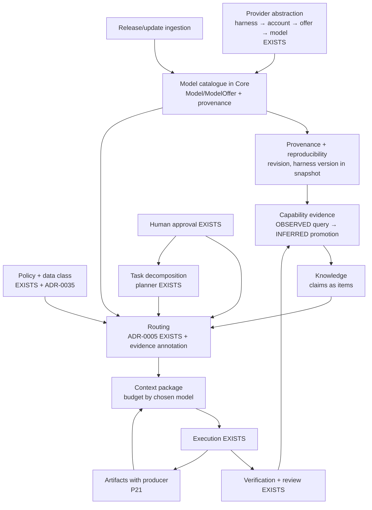

# Archeus V1 — Orchestration Architecture Reconciliation

Status: **DECIDED — architecture finalized 2026-09-30; implementation not started.** The user's
directive of 2026-09-30 set the direction (its clauses A–Z are quoted where they apply); §38
resolves every open decision (O-1…O-16); ADR-0031…ADR-0035 record the decisions; the
rearchitecture plan (P21, P22, §31.2), resource-router §2/§5 and domain-model §8.3 carry the
amendments. Written on `archeus-v1-rearchitecture` at `9165a1f` (the activity halo, the current
P19.5 visual baseline). P18 remains open; the next visual slice remains the P19.5 travelling
marker, which this architecture neither needs nor changes. Where a section says a field or rule
is *not yet built*, the decision is recorded in §38 and the ADRs and the phase that builds it is
named.

Subject: intelligent multi-model orchestration — selecting the appropriate harness, account,
model, effort, skill and tool for each piece of work under policy, evidence, cost, latency,
security, context and reliability constraints; capability knowledge that stays current; and
artifact-first hand-offs between the steps of a mission.

Method: every existing V1 document and ADR named in §2 was read first-hand, the Core code was
inventoried with file:line evidence, the legacy catalogue and OmniRoute code was read, and every
credited and V1 reference was re-inspected at source for this capability specifically (§6, §7,
§33). Where this document says a thing *exists*, a file:line is given; everything else is decided
and not yet built, with its phase named.

## Contents

1. Executive summary
2. Existing architecture baseline
3. New requirement
4. Existing capabilities already present
5. Missing capabilities
6. Reference audit
7. Brud assessment
8. Model/provider abstraction
9. Capability registry
10. Capability evidence
11. Model knowledge lifecycle
12. Release/update tracking
13. Intelligent routing
14. Multi-model orchestration
15. Artifact handoff
16. Context handoff
17. Verification
18. Failure/fallback
19. Human control
20. Policy/security
21. Provenance
22. Reproducibility
23. Cost/latency/quality constraints
24. Local/remote/provider model
25. Skills/tools/agents integration
26. Event/state requirements
27. Visual integration
28. Dependency graph
29. V1/V1.x/post-V1 boundary
30. Phase ownership
31. ADR proposals
32. Conflict matrix
33. Reference traceability
34. Open decisions
35. Rejected/deferred ideas
36. Implementation prerequisites
37. Final architecture summary
38. Decision register

---

## 1. Executive summary

**The capability does not need a new subsystem.** Archeus V1 already routes every unit of work —
a task, a review, and each of Archeus's own calls (planner, brain, extraction, review judge) —
through one deterministic, replayable, explainable function, the Resource Router (ADR-0005,
`archeus/core/routing/router.py`), which selects exactly one (harness, account, model, effort)
and persists why. The mission loop already *is* a multi-model pipeline: a planner call authors
the plan (`CALL_TIERS = {'planner': 'large'}`, `archeus/core/calls.py:44`), tasks execute on a
routed resource sized by `min_model_tier`, Core verifies deterministically, and an independent
review is routed *away* from the accounts that executed (`archeus/core/verification/reviewer.py:94-107`).
Hand-offs already travel as Core-derived artifacts (checkpoints), never as provider state.

What is missing is **knowledge and evidence**, not machinery:

- the model catalogue exists only in legacy code (`claude_sessions/models.py`, OmniRoute's
  `/v1/models`); V1's `Model` and `ModelOffer` entities are defined and never used
  (`archeus/core/domain/entities.py:1305-1322`); `catalog.model_released` is registered and never
  emitted (`archeus/core/domain/events.py:119`);
- capability claims are hand-typed folklore in legacy config (`MODEL_PROFILES` with a 1–5
  `cap` score, a `swe` percentage and `best_for` prose, `claude_sessions/config.py:1134-1139`) —
  exactly the "magic ranking" this document rejects;
- nothing turns execution, verification and review outcomes into capability evidence;
- an artifact has no producer or kind (`entities.py:1185-1195`), so a step's output cannot yet
  be named as the next step's input by anything other than the checkpoint.

**The architecture** (five DECIDED ADRs, §31):

1. **Catalogue as current state** — the dormant `Model`/`ModelOffer` become provenance-bearing
   rows fed by adapters' catalogues through ingestion → validation → provenance → state update →
   routing status CATALOGUED → EVALUATING → APPROVED (RETIRED); discovery is never authorisation
   to route real work; routed offers name exact ids, not moving aliases (ADR-0031).
2. **Capability evidence in four classes** — DECLARED, OBSERVED, INFERRED, UNKNOWN — with the
   evidence *method* stored separately from its *class*, keyed to the exact model revision and
   harness version, never collapsed into a scalar score (ADR-0032).
3. **Evidence advises routing; it does not silently steer it** — the router stays ADR-0005:
   pure, replayable, policy-first. Evidence is annotated on every decision by default; it orders
   candidates (one discrete key) only under a user's `evidence_order` rule and eliminates only
   under a user's `evidence_exclude` rule; every decision freezes the evidence values it
   consulted (ADR-0033).
4. **Artifact-first hand-off between steps** — a step's declared output is an artifact with a
   producer, and the next step's contract names it; there is no hidden model-to-model
   conversation; roles are derived from the task's kind and the decision's subject, not a fixed
   architect/implementer/reviewer/verifier chain (ADR-0034).
5. **Data class constrains providers** — a project's data classification restricts which
   providers and locations may receive its context, decided in Core (ADR-0035).

**V1 minimum is small and mostly already owned** (§29): exact model revision, served-model
provenance and harness version in every decision's snapshot and every execution (P21); the
artifact producer record (P21, already assigned by ADR-0030 §4); the catalogue ported into Core
with freshness, routing status and events, today's offers imported APPROVED so nothing changes
silently (P22); and a migration rule that legacy `MODEL_PROFILES` never becomes routing evidence
(P22). Everything that *uses* evidence to choose is V1.x-O.

**One defect in current V1 surfaced by this audit** (§32 C-20): the Claude Code offers include bare
family aliases (`sonnet`, `opus`) that the CLI resolves to its newest model
(`archeus/harnesses/calls.py:148-158`), so a provider release already changes the model doing the
work with no decision recorded. P22 closes it (exact ids + served-model record).

Brud (`rahatarch/brud`) provides nothing material for orchestration and is not added to the
lineage (§7).

---

## 2. Existing architecture baseline

Read first-hand for this document:

| Document | What it contributes here |
|---|---|
| `docs/architecture/reference/Archeus_v1_System_Specification.md` §14–§16, §19, §32–§34 | harness → account → model → session; the router's inputs (capability, policy, availability, priority, allocation, limits, model requirements, latency, cost); "never silently violate policy"; verification vs review; non-goals |
| `docs/architecture/reference/Archeus_v1_prompt.txt` §12–§13 | "Do NOT collapse Harness, Account, Model, Session"; routing must be explainable; fallback policy-controlled |
| `docs/architecture/reference/Archeus_v1_Implementation_Plan.md` | the source phases (its "new model" is a repository model file, not an AI model — see §32 C-4) |
| `ARCHEUS_V1_REARCHITECTURE_PLAN.md` §14–§16, §31 (P10–P26), §31.2–§31.4 | phase ownership, minimal V1 slice, model-call classes, provider-terms gate |
| `domain-model.md` §1, §5, §7, §8 | modelling rules (three truths, provenance, inferred ≠ explicit, no provider concepts in the domain), KnowledgeItem/Relation, Task/Execution/Checkpoint/Verification/Review/Artifact, Model/ModelOffer/RouteDecision/ProviderTerms |
| `resource-router.md` §1–§11 | the algorithm, tier fit by blast radius, effort economics, prompt hygiene on model upgrade, fallback, explainability, auditability |
| `execution-architecture.md` §1–§3, §6, §8 | adapter contract (`capabilities()` incl. models), vocabulary belongs to the harness, checkpoints, verifier table |
| `context-and-knowledge.md` §1–§5, §7 | three stores, knowledge lifecycle, supersession, decay, external source items |
| `state-machines.md` §2–§7, §9, §11 | mission/task/execution/verification/review/account-health/knowledge machines |
| `api-and-realtime.md` §3 | event envelope, registry, what is event-driven |
| `p10-design-gate.md` §4, §6, §21 | as-built router; cost and latency not keys until reported (D15); `/v1/models` not built |
| `p13-design-gate.md` (via plan §31 P13) | verification worker, independent review |
| ADR-0004, 0005, 0006, 0007, 0012, 0013, 0020, 0021, 0022, 0023 | the decisions this capability must live inside |
| ADR-0024 … ADR-0030, `../design/ARCHEUS_V1_VISUAL_ARCHITECTURE_RECONCILIATION.md` §4, §21, §30 | the visual DNA and the event requirements of halo, pulse, marker, thread |
| `../design/ARCHEUS_V1_DESIGN_SYSTEM.md` §8 | the motion registry as built |
| `../research/external-references.md` | R1–R7 as recorded |
| `docs/credits.md` | the build-on lineage and starter skill collections |

Code inventoried (file:line in §4): `archeus/core/{routing,application,calls.py,planning,
verification,policy,knowledge,context,execution,domain}`, `archeus/harnesses/*`,
`archeus/infra/{artifacts,eventlog}`, `archeus/api/{routes,sse}.py`; legacy
`claude_sessions/{models,omniroute,failover,config,plan_execute,agents,skills}.py`.

Baseline facts that constrain everything below:

- **Three truths, never merged** (domain-model §1.1): current state in entity tables, history in
  `events`, knowledge only by explicit promotion. Knowledge is never inferred from history
  implicitly.
- **The router is pure given a snapshot** (ADR-0005) and replayable from its `input_snapshot`.
- **Explanations are generated from the record, never written by a model** (resource-router §8).
- **The brain proposes; Core applies** (ADR-0006). The planner "does not choose who does it"
  (`archeus/core/planning/planner.py:86-106`).
- **Policy first, enforced by capability removal** (ADR-0007); a harness with `enforcement: none`
  is eligible only when every action class is ALLOW.
- **Vocabulary belongs to the harness** (ADR-0022): a model id is valid only as an offer of the
  target account; never translated.
- **Provider terms** (ADR-0021, OPEN): no real headless call or rotation without the user's
  `permitted` per harness.
- **Visual DNA** (ADR-0024…0029): dark and still at idle; every visual has an underlying event;
  tints never carry meaning.

---

## 3. New requirement

Archeus should eventually do, under its own control, what is done manually today between a human
and several models: research and architecture reasoning → an architecture artifact → an
implementation-capable model → execution → review and verification → correction → a validated
result. The requirement is **not** a fixed model-per-role table. It is that Archeus determines,
from evidence and policy, which available capability fits each piece of work, composes several
when useful, and explains the choice without pretending to certainty.

Restated in Archeus's own terms: *for each routing subject (task, review, own call), compute the
requirement from the subject; select among eligible offers by policy, allocation and the user's
preferences; consult capability evidence that is classified, dated, revision-keyed and
explainable; record the decision so it replays; hand the next step an artifact, not a
conversation; and learn only through recorded outcomes promoted by explicit rules.*

---

## 4. Existing capabilities already present

| Capability | Exists as | Evidence |
|---|---|---|
| (harness, account, model, effort) selection | pure router, STEPS installed → headless → capability → model → enforcement → provider_terms → broker → restriction → breaker → health → allocation → partition → election; ordering affinity, preference, priority, tier, not-near-ceiling, id | `archeus/core/routing/router.py:43`, `:95-114`, `:119-276`, `:284-293` |
| Model step | preferred model if it fits, else smallest tier meeting `min_model_tier`/`min_context_window`; unknown tier = smallest | `router.py:141-167` |
| Routing explanation and replay | `RouteDecision` (requirements, candidates with `eliminated_at_step` + reason, `input_snapshot`, result, `fallback_from`, `unblock_at`, `outcome`); `explain()`, `replay()`; API and `route_explanation` card; `archeus route why` | `entities.py:1424-1469`, `router.py:365-392`, `archeus/api/routes.py:947-949`, `entities.py:561` |
| Model offers per harness | `ModelInfo(id, tier, context_window)`, `Capabilities.models/efforts/structured_output/enforcement` | `archeus/harnesses/base.py:47-65` |
| Claude catalogue in V1 | family aliases + legacy `models.roster()`, tiers from `CLAUDE_TIERS` | `archeus/harnesses/calls.py:145-158` |
| pi catalogue in V1 | pi's catalogue with context windows, no tier | `calls.py:161-172` |
| Tier by blast radius | planner = large; task `min_model_tier` set by the planner; plan cost band = tier weight × estimate | `archeus/core/calls.py:44`, `planner.py:45-65`, `archeus/core/planning/validate.py:148` |
| Allocation, budgets, fallback modes | ceiling semantics, reserve, brain reserve, budgets, `fallback allow|ask`, `route` approval | `entities.py:1330-1349`, `archeus/core/application/resources.py:442` |
| Health and limit latch | account health machine, limit → LIMITED, breaker 5 errors / 600 s | `archeus/core/domain/states.py:285-301`, `archeus/core/application/executions.py:601-651` |
| Mission-scoped resource preferences | preferred/forbidden accounts and harnesses, `max_cost_band` | `resources.py:110`, domain-model §8.6 |
| Own calls on any capable harness | `OwnCalls.run`: route → commit decision → e-stop → terms re-check → `call()` → schema validation, retry once | `archeus/core/calls.py:1-136`, ADR-0022 |
| Independent review | review is an own call with the executing accounts forbidden; `independent` = different harness/account, or same one with another model | `archeus/core/verification/worker.py:358-386`, `reviewer.py:94-107` |
| Deterministic verification with provenance | Core runs inspection-discovered commands; `performed_by`; routed model vs reported model compared | `archeus/core/verification/evidence.py:24-143`, `archeus/core/application/verification.py:79-85` |
| Correction loops | task retry (`execution_failed_retry`, `checks_failed_retry`), bounded replan (`max_replans`, budget guard), `changes_requested` → REPLANNING | `states.py:80-163`, `archeus/core/domain/guards.py:215` |
| Hand-off by artifact | checkpoint derived by Core at every execution end; continuation re-routed through P9/P10 | `archeus/core/execution/checkpoint.py:58-99`, `archeus/core/execution/handoff.py:22` |
| Per-execution model record | `Execution.model`, `effort`, `route_decision_id`, account | `archeus/core/application/work.py:78-96`, `entities.py:919` |
| Provenance on knowledge | `source_kind`, `source_ref`, `observed_at`, `confidence`, `route_decision_id`, `context_package_id`; relations `EXTRACTED|INFERRED|AMBIGUOUS` | `entities.py:409-446`, `:514-535` |
| Freshness in context | freshness/staleness scoring in assembly | `archeus/core/context/assemble.py:417-450` |
| Provider terms | `ProviderTerms` per harness, checked at election and before spawn | `entities.py:1246-1300`, `router.py:190`, `resources.py:406` |
| Content-addressed artifacts | sha256 store with verification on read | `archeus/infra/artifacts/store.py` |
| Event log + SSE | outbox; ids-only frames `{subject, scope}` | `archeus/infra/eventlog/outbox.py`, `archeus/api/sse.py:62-66` |
| Legacy catalogue with the right split | "The API owns facts; this repo owns editorial"; 24 h TTL; bundled floor; retired-pin notices | `claude_sessions/models.py:1-56`, `:95-112`, `:193-238` |
| Legacy OmniRoute health and model classification | live `/v1/models` with context and tool support; circuit/quota exclusion; failover chain | `claude_sessions/omniroute.py:159-407`, `claude_sessions/failover.py:116` |

## 5. Missing capabilities

| Missing | Current state |
|---|---|
| Model catalogue in Core | `Model`/`ModelOffer` unused (`entities.py:1305-1322`); resource-router §2's "ModelOffer rows; stale after 24 h" is unbuilt; `/v1/models` not built (p10-design-gate §21.1 item 7) |
| Release awareness | `catalog.model_released` registered, never emitted; legacy `models.notices()` reports retired pins only, by design |
| Exact revision in the record | `Execution.model` is the harness-vocabulary alias (`claude-sonnet-5`), not the dated snapshot the catalogue knows (`_row()['snapshot']`, `models.py:95-112`); harness `installed_version` not in the decision snapshot |
| Capability evidence | nothing aggregates outcomes per model and task family; only `evidence.provenance` compares routed vs reported model |
| Evidence classes | none for capability claims; the only capability "facts" are legacy editorial numbers |
| Per-step routing hints beyond tier | Task has no role, model, reviewer or verifier field; `task_snapshot` sets `models: {}` and `model_required: False` (`resources.py:342`) |
| Artifact producer and kind | `Artifact(id=sha, media_type, size)` only; domain-model §7.9's `produced_by`/`label` unbuilt; execution output stays in `stream.jsonl` |
| Provider-proxy / OmniRoute in V1 | no adapter or account wiring; only `auth_kind: provider_proxy` exists (`entities.py:1240`) |
| Data-class constraints on providers | policy has no provider/harness/model/account input (`archeus/core/policy/*`) |
| Skills and subagents in Core | none; only inspection records `agent_config` (`archeus/core/world/inspection.py:268`) |
| Cost and latency ordering | specified (resource-router §5) but not keys until an adapter reports them (P10 D15) |
| Adapters declaring `long_context`/`vision` | `CAPABILITIES` has them (`entities.py:813`); no adapter declares them |

---

## 6. Reference audit

Every source was re-inspected at source on 2026-09-30 for *this* capability (README plus the one
to three most relevant files). Fetched content was treated as data. Full rows are in §33; the
material findings:

**Credits / build-on lineage** (`docs/credits.md`)

- **OmniRoute** — the strongest machine-readable catalogue in the set: a `model_capabilities`
  table (tool calling, reasoning, structured output, modalities, knowledge cutoff, release date,
  status, context/input/output limits, `last_synced`) synced every 24 h from the models.dev
  `api.json` aggregator, with a **precedence ladder for each field — user override > models.dev >
  LiteLLM > hardcoded** — and a separate overrides table. Resilience is a three-layer health
  model (provider circuit breaker with half-open probes, connection cooldown honouring
  `Retry-After`, per-model lockout; terminal states cleared only by an operator), and every
  selection carries an inspectable `reason`. Its **Auto-Combo** router, by contrast, is a
  16-factor weighted sum (health, quota headroom, cost, p95 latency, a static task-fitness table,
  a feedback "quality" term neutral at 0.5 until observed, reliability over 24 h with a 10-sample
  floor, 5 % bandit exploration) — the pattern this document rejects as a *selection* mechanism
  while keeping two of its disciplines: **a neutral prior until a sample floor is reached**, and
  **exclude-then-probe back-off** for failing candidates. Archeus's legacy `omniroute.py` already
  consumes its `/v1/models` and health. Its `auto/*` models delegate the choice to that
  server-side router, invisible to Archeus (§32 C-3).
- **olsenbrands/fable-foreman** — the closest precedent for the whole capability. A frontier
  model plans, cheaper workers execute, a **blind verifier** checks (it sees the user's verbatim
  request, the diff and the criteria — nothing else — and runs the real gates first; verdicts
  PASS / FAIL / PASS_WITH_NOTES). Its routing card maps job classes (FRONTIER / WORKHORSE / FAST /
  DECISION) to a seat, a starting effort and fallbacks, flags **NEW MODELS** (live but not in its
  defaults) and **STALE** entries (older than 14 days) and triggers *bounded recon* rather than
  routing to an unevaluated seat; a tiny live call probes access (`LIVE` / `SIGNED_OUT` /
  `BALANCE_EXHAUSTED`); premium seats need the user's approval; raising effort on a cheap seat is
  preferred over raising tier. Its `model-matrix.md` dates and source-tags every number —
  **PRIMARY** (provider docs), **SECONDARY** (third-party measurement), **OBSERVED** (measured on
  this account) — and writes "n/m" rather than back-filling from an incomparable scale. It proves
  which model actually ran as **SERVED / BILLED / ROUTED / REQUESTED** ("do not dress requested
  evidence as served"). Repair goes back to the original builder; two failed fix waves → one
  recovery → `NEEDS USER`. Almost every piece maps onto Archeus's policy + router + verification;
  what is new to Archeus is the evidence discipline (§10) and served-model provenance (§22).
- **anthropics/claude-code** — subagents carry `model` (alias, full id or `inherit`), `effort`,
  `tools`/`disallowedTools`, `isolation: worktree`, `maxTurns`; resolution order is
  per-invocation > frontmatter > `CLAUDE_CODE_SUBAGENT_MODEL` > parent; only the final message
  returns; `SubagentStart`/`SubagentStop` hooks exist. The `code-review` plugin picks a tier *per
  step* (a cheap eligibility gate, parallel specialists on mid and large tiers, then a separate
  validator per finding; unvalidated findings are dropped) — the pattern Archeus's review and a
  future critic step follow. Subagent model choice happens *inside* one execution, invisible to
  Core unless the adapter records it from the hooks (§32 C-16).
- **VoltAgent/awesome-claude-code-subagents** — 150+ agents with a fixed `model:` by role (large
  for security/architecture, mid for coding, small for docs/search) and least-privilege `tools:`
  by role: a *declared* role→tier opinion, hand-written, undated, unevidenced — usable as a
  DECLARED prior, never as evidence.
- **thedotmack/claude-mem**, **Aider repo-map** — context selection by budget and relevance
  (already adopted in P5/P6). Two additions here: claude-mem's compression runs on a configurable
  cheap model (summarisation is a clean task family to route to small or free offers), and
  repo-map's `--map-tokens` budget grows or shrinks with the room available — the same context
  sized to the *chosen* model's window (§16).
- **topoteretes/cognee** — nothing new for routing beyond R4's findings (below).
- **Aider** (beyond repo-map) — the architect/editor split (a reasoning model describes the change
  in prose, an editor model turns it into edits) with measured gains over a model paired with
  itself, and per-model `editor_model_name` / `weak_model_name` / `edit_format` fields in
  `model-settings.yml`. Its polyglot leaderboard records per model and configuration: pass rate at
  1 and 2 attempts, well-formed-edit rate, malformed/syntax/indent errors, exhausted context,
  timeouts, seconds per case, total cost, edit format, command, commit hash, date, versions. The
  split is already Archeus's planner → task split; **the record shape is the model for Archeus's
  own OBSERVED outcome rows** (§10.2); the leaderboard itself is an external benchmark, admissible
  as a dated REFERENCE claim for its own task family only (§10.5).
- **furkankly/zoetrope** — content time ≠ presentation time (§27), and **attribution only from
  recorded ids** (`toolUseId`, `runId`), never heuristics — the rule OBSERVED evidence must follow
  when it attributes an outcome to a model (§10.2).
- **DietrichGebert/ponytail** — its benchmark (a fixed task set, a baseline, n repetitions) is a
  method template for evaluating a model or skill; the skill itself is not relevant.
- **markitdown**, **claude-plugins-official**, **claudemarketplaces.com** — document ingestion,
  plugin packaging, a popularity directory with no feed (installs measure popularity, not
  fitness): not relevant beyond §25.

**Starter skill collections** — **obra/superpowers** is the most complete artifact-first loop in
the set: brainstorm → design doc → a written plan with exact files, tests and verify steps →
subagent-driven development in which the implementer receives a **brief file path** (not the
plan) and writes a report file, answers with a status (DONE / DONE_WITH_CONCERNS / NEEDS_CONTEXT /
BLOCKED), and a reviewer receives a review package (the diff as a file) and checks spec, then
quality. The fix loop is bounded at five rounds; rounds 1–3 resume the same implementer, rounds
4–5 use a fresh one **one tier up**; the final review runs on the top tier followed by one batched
fix wave. Its tier rule (mechanical → cheap, integration → standard, architecture → best, review
sized to the diff) restates blast radius; its warning "an omitted model silently inherits the most
expensive" is why Archeus records the model on every decision. It lives as *prompt discipline
inside one harness*; Archeus holds the same loop as Core state, which survives a session.
**alirezarezvani/claude-skills** has prompt-level `agent-harness`, `human-gate` and a
`skill-doctor` that grades a setup from session history (DEFER); **ComposioHQ** and
**khalilbenaz** add a prompt-only `skill-router` with no evidence behind it (REJECT).

**V1 references R1–R7** (re-inspected; three corrections to `../research/external-references.md`
are recorded in §32 C-15):

- **R1 Munder Difflin** — `registry.json` (role, capabilities, status) is a declared-capability
  record; its *routing lives in the supervisor's prompt* ("tune the prompt, not the code") — the
  opposite of ADR-0005, rejected. Its FIPA-lite envelope (`in_reply_to`, `act` ∈
  request/inform/propose/query/agree/refuse/done, `hops`, `needs_human`) is the useful idea for
  §15: terminal acts make "done" and "refused" explicit — and Archeus already has those as task
  and approval states.
- **R2 Vicoa** — an agent catalogue that merges static entries with **models the machine reports
  at runtime**, and never deletes a model entry after upstream retires it: the direct model for
  DECLARED-shipped vs DECLARED-reported, and for keeping retired rows so history stays readable.
- **R3 Graphify** — EXTRACTED/INFERRED/AMBIGUOUS with a discrete score rubric, a corroboration
  gate (≥ 2 distinct useful outcomes, `_DEFAULT_MIN_CORROBORATION = 2`), a 30-day half-life, and
  content-fingerprint staleness ("code changed — re-verify"). At source the *label* and the
  *method* are mixed (a deterministic resolver emits INFERRED 0.85; an LLM can emit EXTRACTED),
  and the score is not validated — which is why §10 stores method and class as separate fields.
- **R4 Cognee** — valid-time on facts (`time_from`/`time_to`), but unknown month/day default to 1
  (false precision — rejected; precision is stored explicitly); an ontology resolver that
  silently drops unmatched terms (rejected; unmatched = explicit `unmapped`).
- **R5 migration kit** — tier by blast radius (already adopted); sign-off starts the next phase;
  queues are defined by the artifacts on disk; the judge is validated against deliberately broken
  code; costs in bands only. All KEEP, most already adopted.
- **R6 Apple Design Skill** — HIG Generative AI: say when AI acts, what it cannot do and why
  results may be worse, allow refine/revert, confirm significant actions. Principles for the
  routing explanation (§19), no mechanics.
- **R7 Ship Notes** — nothing material for orchestration.

**No reference has an automatic router worth copying, and none links routing to task
outcomes.** Munder Difflin routes by prompt, Vicoa by manual pick, fable-foreman by a hand-kept
routing card, OmniRoute by a weighted score over request-level signals (latency, headroom, a
static fitness table). None feeds verified task outcomes — tests passed, verifier verdicts, review
verdicts per task family — back into selection. That is exactly the evidence Archeus already
records, and the reason to introduce it conservatively (annotate by default; order or exclude only under an explicit rule, §13).

---

## 7. Brud assessment

`rahatarch/brud` (MIT, TypeScript, created 2026-09-01, 5 stars, v0.1.3; a fork of "Akkhar Code
Patcher") is a VS Code extension for a manual paste-and-apply loop: the user pastes a master
prompt into any chatbot's web UI, pastes the chatbot's text "Brud blocks" (SEARCH/REPLACE plus
~21 operations) back into a sidebar, previews and applies. **It makes no model calls at all**; the
human is the transport.

| Area | Finding |
|---|---|
| Agent orchestration, model routing, task delegation, autonomous workflows, planning, multi-agent coordination, provider abstraction, model evaluation, capability metadata, release freshness | nothing material |
| Tool selection | a `ToolDoc` registry; the model must fetch a tool's guide (`GET_TOOL_INFO`) before using it (`packages/core/src/tool-registry/*`, `masterPrompt.ts`) |
| Context management | directory-tree extractor and import follower; no budgeting |
| Observability | local per-session edit history (`history/types.ts`) — file edits only |
| Reliability / recovery | single-match whitespace-insensitive matcher; per-session snapshot and revert (`history/revert.ts`) without a changed-since check |
| Human control | diff preview + explicit apply (its core); a 17-regex command blocklist and a prefix-match workspace check (`startsWith`), both bypassable |

| Concept | Verdict | Why | Location if ever used |
|---|---|---|---|
| Model fetches a tool's guide before use | DEFER | helps text-only harnesses (a provider proxy with no native tool calling); native tool-calling harnesses do not need it | §24, provider-proxy adapter (V1.x) |
| Tool guide generated from the registry the code executes | KEEP (principle, already practised) | same rule as Archeus's generated API docs | — |
| Snapshot + per-execution revert | DEFER | Archeus uses worktrees and Core-only merge; a revert would need a drift check Brud lacks | — |
| Structured error `{code, friendly, details}` | KEEP (already practised) | matches the 400/422 discipline | — |
| Regex command blocklist, prefix workspace check | REJECT | bypassable; Archeus relies on capability removal and canonicalised hook checks | — |
| Paste-back result summary | REJECT | Archeus has an event log and a programmatic loop | — |

**Verdict: Brud is not added to Archeus's reference lineage.** It provides nothing material for
orchestration; its three real mechanisms (human approval, local undo, tool self-documentation)
are already covered more rigorously. The two DEFER rows are recorded here so they are not
rediscovered.

---

## 8. Model/provider abstraction

**Keep the existing hierarchy; do not add a "provider" layer to the domain.** The spec and prompt
are explicit — harness, account, model and session are four things (resource-router §1) — and
domain-model §1.7 forbids provider concepts in domain fields. A *provider* (Anthropic, OpenAI, a
local runtime, an OmniRoute upstream) is a **property of a model offer and of an account's
`auth_kind`**, not a fifth routing object:

```text
Harness (runtime: claude_code, codex, pi, generic_cli)
  └─ Account (credentials on a node; auth_kind subscription_oauth | api_key | provider_proxy)
       └─ ModelOffer (this account can use this model, as of observed_at, via route_kind)
            └─ Model (a catalogue row: exact id + revision, family, facts with provenance)
                 └─ Session → Execution (records the exact revision it ran on)
```

Decided additions (ADR-0031; P21/P22), all on the existing entities:

| Entity | Field | Meaning |
|---|---|---|
| Model | `provider` | who serves the weights, as the catalogue states it (`anthropic`, `openai`, `local`, an upstream name reported by a proxy); display and policy input only |
| Model | `revision` | the exact provider snapshot (e.g. the dated id behind an alias); `null` when the source does not say |
| Model | `alias_of?` | an alias row points at the revision it resolved to at `observed_at` |
| Model | `location` | `remote` \| `local` — the data-residency fact §20 needs |
| Model | `retired_at?`, `deprecated_at?` | never delete a row (R2); a retired row keeps history readable |
| Model | provenance | `source_kind` (catalogue \| adapter \| user \| import), `source_ref`, `observed_at` |
| Model | routing status | `CATALOGUED` → `EVALUATING` → `APPROVED`; `RETIRED` from any (back to `CATALOGUED` on reappearance); `user_withdraws` → `CATALOGUED`. Moves out of CATALOGUED/EVALUATING by the user or a standing approval rule the user created, cited by the move. Routable = APPROVED (EVALUATING for an evaluation subject) ∧ offer available ∧ not forbidden — derived, never stored. "Discovered" is the ingestion moment, not a state (ADR-0031 §4) |
| ModelOffer | `route_kind` | `direct` (exact id) \| `alias` (a family alias the harness resolves itself — offered only when the harness takes nothing more exact) \| `proxy` \| `opaque_router` (a proxy that chooses the upstream itself, e.g. OmniRoute `auto/*`) |
| ModelOffer | `observed_at`, `available` | stale after the catalogue TTL (resource-router §2's 24 h) |

The **vocabulary rule stays** (ADR-0022): the id a harness is given is the offer's id in that
harness's vocabulary. `revision` is what Archeus *records*, not what it sends.

---

## 9. Capability registry

**Yes, a first-class registry — but it is the catalogue plus evidence, not a table of scores.**
It answers two different questions and must not merge them:

| Question | Store (domain-model §1.1) | Contents |
|---|---|---|
| "What does this model *have*?" (facts) | **current state** — Model / ModelOffer rows | context window, max output, modalities, tool support, structured output, efforts, price where a source states it, rate limits where reported, location, release/deprecation dates, availability — each with `source_kind` and `observed_at` |
| "What is this model *good at*?" (claims) | **knowledge** — KnowledgeItems anchored to the model, plus a query over history | strengths, weaknesses, failure modes, task-family outcomes — each classified DECLARED / OBSERVED / INFERRED / UNKNOWN (§10) |

Conceptual schema of a **capability claim** (ADR-0032; V1.x-O1):

| Field | Meaning |
|---|---|
| `subject` | `{kind: model, id, revision?}`; optionally `+ harness_id` and `+ skills[]` when the claim is about a composite (§25) |
| `task_family` | the routing class the claim is about (§10.3); never "general" |
| `claim` | a controlled term from the capability vocabulary (e.g. `completes_code_change`, `follows_schema`, `long_context_recall`, `tool_use_reliable`, a failure mode such as `stops_early`); an unmatched term is stored as `unmapped`, never dropped (R4 correction) |
| `polarity` | supports \| contradicts |
| `class` | DECLARED \| OBSERVED \| INFERRED \| UNKNOWN (never AMBIGUOUS — that is a *relation* tier; see §32 C-11) |
| `method` | provider_catalogue \| provider_docs \| benchmark \| archeus_outcome \| human \| legacy_editorial — stored **separately** from `class` (R3 correction) |
| `sample` | for OBSERVED/INFERRED: `n`, successes, failures, window, distinct missions |
| `valid_from`, `valid_until`, `precision` | valid-time with explicit precision (day \| month \| unknown) — never default an unknown day to 1 (R4 correction) |
| `revision_key` | model revision + harness version the evidence was gathered on; a change marks it stale (R3 fingerprint idea, keyed on revision) |
| provenance | existing KnowledgeItem columns: `source_kind`, `source_ref`, `observed_at`, `route_decision_id` |
| `state` | the KnowledgeItem machine (CANDIDATE → CONFIRMED → SUPERSEDED/RETRACTED/EXPIRED) |

**No numeric capability score is stored.** The requirement's field list (coding ability,
reasoning ability, …) becomes `(task_family, claim, class, sample)` rows. "Coding ability 4/5" is
not representable, on purpose.

---

## 10. Capability evidence

### 10.1 Four classes

| Class | Definition | Produced by | May it change routing? |
|---|---|---|---|
| **DECLARED** | a provider, catalogue, model card, harness descriptor or user says the model supports X | catalogue ingestion; provider docs as REFERENCE items; user annotation | facts (context window, tool support, efforts) are already hard requirements in the router's capability/model steps; declared *performance claims* (incl. benchmarks) never order or exclude (ADR-0032 §7) |
| **OBSERVED** | Archeus has recorded outcomes of its own executions, verifications and reviews | a deterministic, versioned **query over history** (Execution × Verification × Review × RouteDecision) — not stored as knowledge (domain-model §1.1); its values are frozen into each decision that consults it | annotation by default; orders or eliminates only under a user rule and only when sufficient (§13) |
| **INFERRED** | Archeus derived a claim from accumulated evidence | an explicit promotion step, corroboration-gated (≥ 2 distinct missions, the P6 LESSON rule and R3's gate) → a `CAPABILITY` KnowledgeItem, CANDIDATE → CONFIRMED | annotation by default; orders or eliminates only under a user rule (`evidence_order` / `evidence_exclude`), and only when CONFIRMED |
| **UNKNOWN** | insufficient evidence | absence of rows | a candidate is never penalised for being unknown; it is labelled "unprofiled" (the legacy rule "visible and unprofiled beats absent", `models.py:14-17`) |

### 10.2 What counts as an outcome

From rows that already exist, per execution: task reached VERIFIED on first attempt / after
retries / FAILED (`failure_class`); verification PASSED / FAILED / ERROR (ERROR is the verifier's
fault and is **excluded**); review verdict and `independent`; `changes_requested` count; hook
denials; `exit_reason`; usage and cost; duration; hand-offs by pressure; and the routed-vs-reported
model check (`evidence.py:111-143`) — an execution whose reported model differs from the routed
one is attributed to the reported model or excluded, never to the routed one. Attribution uses
recorded ids only (zoetrope's rule), and the served model carries a provenance level after
fable-foreman: **REQUESTED** (what Archeus sent) < **ROUTED** (what the proxy says it chose) <
**SERVED** (what the transcript's `message.model` shows) < **BILLED** (what usage attributes);
OBSERVED evidence counts only SERVED or BILLED. The row shape follows Aider's leaderboard record
(pass at first/second attempt, well-formed output, errors by kind, exhausted context, timeouts,
duration, cost, versions). Human feedback on a route decision is Feedback (domain-model §7.8) and
promotes only explicitly.

Explicitly **not** outcomes: the model's own summary (never the completion signal,
execution-architecture §3), model self-confidence (never an input, P6 D4), and anything a
Claude Code subagent did inside the execution under another model (§32 C-16).

### 10.3 Task family

A claim is always about a task family. **Decided (ADR-0032 §3, O-5/O-6):** a closed,
migration-extendable vocabulary on the task contract, `task_family` ∈ {architecture, planning,
coding, debugging, testing, code_review, security_review, documentation, research, ui_design,
verification, summarisation}, proposed by the planner and validated by Core. When absent it is
derived: `code_change` → coding, `research`/`inspection` → research, `document` → documentation,
`presentation` → ui_design, `verification` → verification; subject `review` → code_review; own-call
purpose `planner` → planning, `knowledge_extraction`/`lesson`/`generation` → summarisation.
Observations keep their context (effort, skills, route kind) and summaries group by **(model
revision, harness version, task family)** with the context shown as a breakdown, so samples are
not split until they can bear it. Naming the family is not naming a model.

### 10.4 Uncertainty, sample size, recency, source precedence

- Every OBSERVED/INFERRED summary carries `n` and the window; below the floor (`n < 5` on the
  current revision and harness version, O-13) it is rendered "too few runs" and can neither
  order nor exclude.
- Recency: evidence gathered on an older `revision_key` is shown as *stale* and not counted as
  current; there is no half-life arithmetic in V1.x (R3's 30-day half-life is DEFERRED; revision
  change is the staleness signal; time decay is post-V1 — O-13).
- **Source precedence is per question, not a global order:**

| Question | Wins | Why |
|---|---|---|
| a *fact* (context window, tool support, price, deprecation) | user override (explicit, dated) → the provider's own catalogue at the latest `observed_at` → provider docs → an aggregator such as models.dev, if O-11 admits it → the bundled floor table | OmniRoute's ladder, reordered so the provider's own catalogue outranks an aggregator; each field records which rung it came from |
| "does this model succeed at *this* task family *here*" | OBSERVED with sufficient `n` on the current revision → INFERRED (confirmed) → external benchmark for the same family → DECLARED prose | Archeus's own verified outcomes are the only evidence about *this* workspace; a benchmark is evidence about *its* task family |
| conflict between two sources | neither silently: both shown, the claim becomes CANDIDATE with `contradicts`, surfaced as a knowledge proposal | domain-model §1.4, context-and-knowledge §3 |

A small number of Archeus runs never overrides broad evidence (the `n` floor); broad evidence
never overrides a sufficient local sample for its own family.

### 10.5 Benchmarks

A benchmark result is a DECLARED/`benchmark` REFERENCE item: `{benchmark, version, task family it
measures, score as published, source_url, observed_at}`. It supports a claim about the benchmark's
own family only; it is never normalised across benchmarks into an intelligence score, never used
as a routing key, and is shown in an explanation as "external benchmark, not measured here".

---

## 11. Model knowledge lifecycle

Three different things, three different owners — the requirement's distinction, mapped:

| Concept | What it is | Store | Writer | Changes routing? |
|---|---|---|---|---|
| **Model knowledge update** | a catalogue fact appeared or changed (new model, new context window, price, deprecation) | Model/ModelOffer rows (current state) + event | the catalogue consumer (a Core command) | only availability (a model that disappeared is unavailable); a *new* model is routable only after the user (or the user's standing rule) approves it (§12) |
| **Capability evaluation** | outcomes aggregated for a (model revision, task family) | query over history; promoted INFERRED claims in knowledge | a query (no writer); promotion pass (writer, corroboration-gated) | advice; `enforce` only by user rule |
| **Routing decision** | one selection for one subject | RouteDecision row + `route.decided` | the router, as today | it *is* the routing |

Lifecycle of a catalogue fact:

```text
adapter catalogue read (Anthropic /v1/models via the account's own token; pi's catalogue;
                        a provider proxy's /v1/models)          ── ingestion
  → schema validation (unknown fields dropped, types checked,
     a malformed catalogue rejected whole, the last good one kept) ── validation
  → provenance stamped (source_kind catalogue, source_ref, observed_at) ── provenance
  → Model/ModelOffer upsert in one writer transaction + event   ── knowledge update
  → offer eligible per the new-model rule (§12)                 ── routing availability
```

Freshness metadata on every fact: `observed_at`, `source_ref`, TTL (24 h, the legacy
`CATALOG_TTL`); a fact older than its TTL is *stale* — still used (the bundled table is the floor,
never the ceiling, `models.py:25-28`) but the decision records its age, exactly as usage
staleness is recorded today (resource-router §4). "Unknown" is never read as zero (the same rule
that rejected `quota.worst_window`).

This is **not self-modification**: ingestion writes facts about external models; no step edits
policy, routing rules, prompts or code. Resource-router §6's "prompt hygiene on model upgrade"
stays what it is — an automation that *proposes*.

## 12. Release/update tracking

**The lifecycle** (ADR-0031 §4; terms from the existing architecture — a routing *status* on the
catalogue row, not new concepts):

```text
ingestion (discovery — an event, not a state)
  → CATALOGUED   provenance, revision, facts, source and date recorded; routable for no real work
  → EVALUATING   user allowed evaluation: routable only by an evaluation mission or an explicit pin
  → APPROVED     user (or a standing approval rule the user created) approved: routable
  RETIRED        provider withdrew it (from any state; back to CATALOGUED if it reappears)
routable = APPROVED (EVALUATING for an evaluation subject) ∧ offer available ∧ not forbidden
```

**Invariant: discovery ≠ authorisation to route real work.** Safe learning before dependence is,
and is only: (a) an **evaluation mission** (below), approved like any mission, which may take the
form of a *shadow evaluation* — re-running already-completed tasks from their frozen contracts in
an isolated worktree on the EVALUATING model, verified the same way, its result never merged; and
(b) an explicit user pin on low-risk work. There is no exploration share of real missions.

| Signal | Source | Event (new unless noted) | Effect |
|---|---|---|---|
| new model | catalogue diff | `catalog.model_released` (registered, `events.py:119`) | Model row in CATALOGUED; **not** routable for real work until the user (or a standing approval rule the user created) moves it (ADR-0031 §4) |
| model changed (context, efforts, price) | catalogue diff | `catalog.model_changed` | row updated; evidence on the old revision marked stale when `revision` changes |
| deprecated / retired | catalogue absence or dated field | `catalog.model_retired` | offer unavailable; a pinned preference naming it becomes an Attention item (legacy `notices()` behaviour, `models.py:217`) |
| harness upgraded | node discovery | `harness.state_changed` (exists) | evidence keyed on the old harness version marked stale |
| provider docs / changelog | **not auto-ingested in V1.x**; a user- or automation-created REFERENCE item | `knowledge_item.created` (exists) | DECLARED claim, CANDIDATE |
| benchmark update | same | same | §10.5 |

A newer model is **never presumed better**. Its evidence starts UNKNOWN; its DECLARED facts may
make it eligible for a requirement it did not meet before; that is all. fable-foreman's NEW /
STALE flags are the right trigger, and its "bounded recon" is the right response — in Archeus a
recon is an **evaluation mission proposed by an automation** (fixed task set, baseline, n
repetitions — ponytail's method), which spends quota and therefore goes through plan approval
like any mission. It is V1.x-O1, never automatic.

---

## 13. Intelligent routing

**The router remains ADR-0005.** Model selection is a routing decision, and the routing decision
stays a pure, replayable function of (requirements, snapshot). The change is small and explicit
(ADR-0033, DECIDED; built in V1.x-O2, its record fields in P21):

```text
requirements_for(subject)            # unchanged: capabilities, action classes, min tier,
                                     #   context, preferred/forbidden, cost band
  + task_family                      # ADR-0032, from the contract or derived; recorded
  + exact_provenance                 # true for every task and review
snapshot(now)                        # unchanged: health, usage + age, ledger, policy version
  + catalogue row versions, harness versions
  + capability_snapshot              # the VALUES of every summary/claim consulted, the query
                                     #   version, as_of_seq and the evidence rules in force
eliminate: installed → headless → capability → model (routing status APPROVED; EVALUATING
           only for an evaluation subject) → enforcement → provider_terms
           → restriction (+ data class, ADR-0035) → provenance → health → allocation
           → evidence            # only under a user's `evidence_exclude` rule
order:     affinity → preference → priority
           [→ evidence_fit, only under a user's `evidence_order` rule]
           → tier fit → not-near-ceiling [→ cost → latency, when measured, P10 D15] → id
record:    RouteDecision + per-candidate evidence annotation + explanation
```

Rules:

1. **Policy and resource constraints always come before evidence** (clause H). A capable model
   the policy excludes is excluded; a model with excellent evidence on an account at its ceiling
   is not started.
2. **Evidence never lowers a safety floor.** `min_model_tier` by blast radius and the review's
   independence rule stand; evidence works *within* them and never admits a candidate a floor
   excluded.
3. **Annotate is the default everywhere** (O-4): each candidate's row carries `evidence {class,
   n, window, revision_current, method}`; the explanation lists the evidence consulted and the
   evidence ignored as stale or insufficient; selection is unchanged.
4. **Order is a named user rule, `evidence_order`**, enabled per task family and scope (global /
   workspace / project / mission; versioned; cited by the decisions it affects). It adds exactly
   one discrete key, `evidence_fit` ∈ {sufficient supporting; none or insufficient; sufficient
   contradicting}, after the user's own preference and priority and before tier fit, and applies
   the same way inside the model step among offers meeting the minimum. This is how "a model may
   be selected because its recorded evidence is appropriate to the task family" (clause F) holds
   without a score.
5. **Exclude is a named user rule, `evidence_exclude`**, per task family and scope: it
   eliminates a candidate with CONFIRMED contradicting evidence on the current revision, with a
   reason (clause J). Stale or insufficient evidence never excludes.
6. **Only OBSERVED-sufficient and CONFIRMED INFERRED evidence counts** for rules 4–5; DECLARED
   performance claims (including benchmarks) never do.
7. **No model decides the route** (ADR-0005's rejected alternative stays rejected). The planner
   states requirements (including `task_family`); the router chooses; only the user names a model.
8. **No composite score, ever** (clauses D, E). Every effect is an elimination with a reason or a
   named discrete key.
9. **The explanation answers five questions from the record** (§7 of the directive): why each
   candidate was eligible or eliminated (step + reason); which policy constraints applied
   (policy decision, data class, terms, restrictions); which evidence was consulted; which was
   ignored and why (stale revision, below `n`, DECLARED-only); why the selected candidate was
   ordered first (the deciding key). Example:

> **Selected:** Account A · Claude Code · `claude-sonnet-5` (exact revision recorded), task family
> *coding*. **Eligible because** it offers `code_edit`+`shell`, meets tier *mid*, its data class
> *internal* allows Anthropic, and it is at 41 % of its 80 % ceiling. **Ordered first by** your
> priority (P1); `evidence_order` is on for *coding* in this project and it has 11 verified coding
> tasks on this revision, 10 first-attempt passes. **Not used:** `gpt-5.x-codex` (Account B) —
> ordered after A by priority; its evidence (3 tasks) is below the sample floor and was not used.
> `auto/coding` via OmniRoute — eliminated at *provenance*: it cannot guarantee a record of the
> model that serves the work. **Ignored:** 6 coding tasks on the previous revision of
> `claude-sonnet-5` (stale).

## 14. Multi-model orchestration

**Roles are not entities; they emerge from what the step is.** The existing subject and task kind
already name every role the requirement lists:

| Requirement's role | Archeus today | Routed as |
|---|---|---|
| researcher | task `kind: research` (+ ResearchVerifier) | subject `task` |
| architect / planner | own call `purpose: planner` (`large`) | subject `archeus_call` |
| implementer | task `kind: code_change` / `document` / `presentation` | subject `task` |
| tester / verifier (deterministic) | CodeVerifier, DocumentVerifier, AutomationVerifier — **no model** | not routed |
| verifier (model) | ResearchVerifier / DocumentVerifier model part | own call (V1.x: purpose `verification`) |
| reviewer / critic | subject `review`, routed away from executing accounts | subject `review` |
| fact-checker / synthesizer | task kinds `research` / `document` with acceptance criteria | subject `task` |
| small task, one capable agent | a one-task plan | subject `task` |

So the pipeline "architecture → implementation → review → verification → correction" is the
**mission loop that exists**: planner call → plan (versioned, approved by policy) → tasks in a DAG
→ verification → review → `changes_requested` / `verification_failed` → REPLANNING (bounded) or
task retry. Composition is the plan's DAG; the planner chooses the shape, Core validates it, the
router chooses each resource.

What V1.x-O3 adds (ADR-0034):

- **An architecture step as a task.** A plan may contain a `document`-kind task whose
  `expected_output` is an architecture artifact and whose dependants name it in `inputs[]`. No new
  kind is needed; `min_model_tier: large` expresses the blast radius.
- **An optional critic step** — a second review (another independent resource) requested by the
  mission's `review_strategy` or by the user (§19). It is a Review row, not a new entity.
- **`task_family` on the task contract** (ADR-0032 §3, O-6): kind + capabilities cannot tell
  architecture from ordinary documentation, or debugging and security review from coding, so the
  planner proposes a family from the closed vocabulary and Core validates it. It names the kind
  of work, never the model.

### 14.1 First-class example: the architecture → implementation → review workflow

The workflow the user runs by hand today between a reasoning model and a coding model, expressed
in Archeus's existing objects. **No provider is named by the architecture**: every "selected"
below is a RouteDecision computed from policy, requirements, catalogue, evidence, availability,
cost band, data class and independence — ChatGPT-as-architect and Claude-as-coder are one
possible outcome, not a rule.

| Stage | Archeus object | Requirement the router sees | Output (artifact, ADR-0034) | Gate before the next stage |
|---|---|---|---|---|
| 0. Request | Message → Intent → Mission (objective, requirements, constraints, success criteria) | — | — | P7 challenge/clarification; P9 policy |
| 1a. Plan | own call, purpose `planner` | `task_family: planning`, `min_model_tier: large` (`CALL_TIERS`), structured output | PlanVersion: task DAG, acceptance per task, `approval_points` | plan validated by Core; P9 plan decision (approval if the autonomy profile asks) |
| 1b. Architecture reasoning | task t1, `kind: document`, `task_family: architecture`, read-only action classes | `min_model_tier: large`, `long_context` if the repository needs it, exact provenance, data class | `architecture` artifact: architecture, decisions (`DECISION:` lines → DECISION items), constraints, implementation plan detail, acceptance criteria | DocumentVerifier (sections present, links resolve) → optional independent review → human acceptance when the plan put an approval point here — the step the user performs manually today |
| 2. Implementation | tasks t2…tn, `kind: code_change`, `task_family: coding`, `inputs: [t1's artifact]`, worktree | `code_edit`+`shell`, tier by blast radius, write action classes → enforcement `hook`/`sandbox` | `patch` artifact (the verified commit) + checkpoint | CodeVerifier on the task's worktree: inspection-discovered tests/build/lint (deterministic, no model) |
| 3. Independent review | subject `review` (own call), routed with the executing accounts forbidden | `task_family: code_review`; `independent` recorded | `review` artifact: requirements met/missing, risks, regressions, verdict | reviewer sees the verbatim request, the artifacts, the diff and the evidence — never the implementer's transcript |
| 4. Mission verification | CodeVerifier on the mission branch; success criteria | deterministic | Verification rows | only verified + reviewed missions complete |
| 5. Outcome | COMPLETED / REPLANNING / BLOCKED | — | the rows above | — |
| 6. Evidence | OBSERVED query over the rows above | — | per (model revision, harness version, family) summaries | frozen into future decisions' `capability_snapshot` |

Order: Archeus verifies deterministically per task *before* review (a failing test makes a review
wasted), then reviews, then verifies the mission — both gates are required either way.

**On failure** (each already a state-machine edge; §18):

```text
verification FAILED ─▶ task retry (max_attempts, same requirement)
                   ─▶ [escalate_on_repeated_failure rule on] retry one tier up, recorded
                   ─▶ task FAILED ─▶ REPLANNING (max_replans) ─▶ new PlanVersion
review CHANGES_REQUESTED ─▶ REPLANNING (max_replans)
verification ERROR ─▶ retry once ─▶ Attention (the human)
no eligible resource ─▶ `ask` approval or BLOCKED with unblock time
budget exhausted ─▶ BLOCKED, the human decides
```

**What is recorded at every stage:** the RouteDecision (why this model: eligibility, policy,
evidence consulted/ignored, deciding key), the exact model revision and served model, the context
package, the artifact produced, the verification/review rows. That is the whole of what the user
currently keeps in their head between the two chat windows.

### 14.2 Specialisation over time

The three statements the requirement names are each a record, never a number:

| Statement | Representation | Effect on routing |
|---|---|---|
| "Model X has repeatedly completed this task family successfully." | OBSERVED summary for (X's revision, harness version, family): `n`, first-attempt passes, retries, review verdicts — sufficient at `n ≥ 5`; promoted, after ≥ 2 distinct missions, to a CONFIRMED `CAPABILITY` claim `supports completes_<family>` | annotated always; ordered first among equals only where `evidence_order` is on for that family |
| "Model Y frequently requires retries for this task family." | the same summary showing retries / `checks_failed_retry` counts; promotable to `contradicts first_attempt_<family>` | annotated; orders Y after candidates with supporting evidence under `evidence_order`; excluded only under `evidence_exclude` |
| "Model Z is suitable for review but should not independently perform this class of implementation." | two claims on Z: `supports` for `code_review`, `contradicts completes_coding` — the family is what separates them | with `evidence_exclude` on for `coding`, Z is eliminated from implementation tasks (reason recorded) and stays eligible as a reviewer |

Each is inspectable down to the executions it counts, and each goes stale when Z's revision or
harness version changes.

## 15. Artifact handoff

**Model-to-model collaboration runs through explicit artifacts, never through hidden
conversational state** — the rule the checkpoint already follows (execution-architecture §6) and
the R5 discipline ("queues are defined by what exists on disk").

The next step must know, and each item has an existing home:

| The next step must know | Where it lives |
|---|---|
| what was requested | Mission objective, requirements, constraints, success criteria; Task contract (objective, expected_output, boundaries, acceptance) |
| what was decided | `DECISION:` lines + DECISION items (checkpoint `decisions[]`); the approved PlanVersion (digest) |
| what was produced | **the declared output artifact (ADR-0034; producer P21, declared outputs V1.x-O3)** — `Artifact` gains `produced_by {kind: execution, id}`, `task_id`, `kind` (architecture \| plan \| patch \| report \| test_result \| review \| checkpoint \| transcript_excerpt), `label` — domain-model §7.9 already specifies `produced_by`/`label`; ADR-0030 §4 already assigns "execution → produced object" to P21 |
| what remains | checkpoint `open_problems[]`, `next_action`; the task graph |
| what evidence exists | Verification rows (checks, output artifacts), Review rows |
| constraints | Task boundaries, action classes, policy decision |
| what must not be changed | Task `boundaries[]`, `touches[]` complements, ARCHITECTURE constraints (context-and-knowledge §6) |

Hand-off protocol (R1's envelope, adapted to state that already exists): the "act" of a finished
step is the task's terminal state, not a message — `done` = VERIFIED (+ review verdict),
`refuse` = FAILED with `failure_class` or BLOCKED with reason, `needs_human` = an Approval,
`hops` = the causal/replan depth caps already enforced. superpowers' implementer statuses map the
same way: DONE = the execution ended and verification runs; DONE_WITH_CONCERNS = VERIFIED with the
concerns carried as `open_problems` for the reviewer; NEEDS_CONTEXT = a clarification (P7's
card, not a new state); BLOCKED = BLOCKED with reason. superpowers' and fable-foreman's *brief
file* is Archeus's rendered task contract + context package, already delivered as the prompt's
variable suffix; the *report file* is the declared output artifact. A downstream task
starts only from a **verified** upstream artifact at a recorded revision; an unverified artifact
is never an input.

## 16. Context handoff

The selected model receives a **ContextPackage** (domain-model §5.3), which already records what
was selected, why, at which `as_of_seq`, under which budget. Decided extensions (ADR-0034 §4; V1.x-O3):

- **Budget by the selected model**, not a constant: the package's token budget derives from the
  chosen offer's `context_window` (the router runs before assembly for execution; for a
  hand-off the continuation is re-routed, then assembled). Pressure maths already reads the live
  catalogue window (execution-architecture §6).
- **Upstream artifacts as L-level items**: an input artifact named in `inputs[]` is included
  whole when it fits, else by reference with a Core-rendered summary; the package records which.
- **Role-shaped selection**: a reviewer gets the user's verbatim request, requirements,
  constraints, the diff and verification evidence, and deliberately *not* the implementer's
  transcript or summary (fable-foreman's blind verifier; independence); an implementer
  gets the architecture artifact and repository context (repo-map-style budgeted). This is a
  selection rule per subject kind, recorded in the package's `scoring`.
- Never the whole context to every model (Claude-Mem, Cognee, repo-map lineage; spec §34
  "memory is not an unbounded transcript dump").

## 17. Verification

Unchanged principles: a process exit is evidence, never success; verification ≠ review; ERROR ≠
FAILED; only verified + reviewed missions complete. For this capability:

- **Verification outcomes are the primary source of OBSERVED evidence**, which is why they must
  keep `performed_by` and the executing resource (they do, `verification.py:79-85`).
- **The judge must be proven to fail** (R5): any evidence-driven routing rule is only enabled
  after its verifier has been mutation-verified — the repository's standing rule applied to
  evidence.
- **Model verifiers** (research, document) are own calls routed independently of the producing
  resource, like review.
- A reviewer disagreeing with the implementer is the existing `changes_requested` path; a second
  reviewer disagreeing with the first is surfaced to the human, never resolved by majority.

## 18. Failure/fallback

Fallback is **another valid capability under policy, or a question, or a stop** — never "the most
powerful model". It extends resource-router §7:

| Situation | Behaviour |
|---|---|
| model unavailable / offer stale and absent | eliminated at `model`; the next eligible offer by the same ordering; none → `fallback_or_block` as today |
| quota exhausted | account LIMITED, hand-off by checkpoint, re-route (exists) |
| timeout | execution ends `error`; task retry within `max_attempts` (exists); repeated → breaker (exists) |
| invalid output (schema) | own call: retry once, then ask (ADR-0006); task: verification FAILED |
| reviewer disagrees | `changes_requested` → REPLANNING within `max_replans` (exists) |
| verifier fails | FAILED → retry or fail the task; ERROR → retry once then Attention (exists) |
| context exceeds capacity | eliminated at `model` by `min_context_window`; mid-run → pressure hand-off (exists) |
| tool use fails | hook denial → `open_problems`; policy/credential failures are not retryable (exists) |
| capability knowledge stale | used with its age recorded; an `evidence_exclude` rule on stale evidence does **not** fire (stale evidence cannot exclude or order) |
| a newer model is unknown | UNKNOWN evidence; eligible only per the new-model rule; never preferred for being new |
| selected model deprecated | offer unavailable; a user pin naming it → Attention; affinity dropped |
| no candidate at all | **stop and ask the human** — BLOCKED with the earliest unblock time, or an `ask` Approval (exists) |

Escalating to a *larger* tier is allowed only when the requirement's minimum is unmet by anything
smaller that is eligible — which is already the tier-fit rule — and is recorded as such.
Escalation after repeated failure exists only as the named rule `escalate_on_repeated_failure`
(ADR-0033 §7, O-16; off by default; V1.x-O2), superpowers' bounded escalation: after the second
charged failure of the same task, the retry's `min_model_tier` rises by exactly one tier, the
decision records the rule and `escalated_from`, and the loop still ends at the human
(fable-foreman's `NEEDS USER`) — never an open-ended climb.
Repeatedly failing offers may be excluded for a back-off window and probed on return (OmniRoute),
which is the existing breaker applied per offer rather than per account.

## 19. Human control

| The human can | Mechanism | Built? |
|---|---|---|
| approve a plan | P9 plan approval | yes |
| prohibit a provider/model/account/harness | `forbidden` in mission preferences; account `project_deny`; forbidden models and providers in the same shape (V1.x-O2); data class (ADR-0035, V1.x-O4) | partly |
| pin a model | `model_required` preference (router `:141-167`) — own calls today; on a task or mission (V1.x-O2) | partly |
| override routing for a mission | `resource_preferences`; "use account A first" → mission-scoped fallback chain | yes |
| reject a hand-off | plan `approval_points[]` on a task boundary; an Approval before a downstream task consumes an upstream artifact when the autonomy profile asks (ADR-0034, V1.x-O3) | partly |
| inspect why a model was selected | `archeus route why`, `route_explanation` card, `/v1/route-decisions` | yes |
| inspect the evidence behind it | the decision's frozen `capability_snapshot` rendered with class, `n`, window, method, staleness (V1.x-O2) | no |
| inspect model provenance | Execution → RouteDecision → Model revision, served model + level, source (P21/P22) | partly |
| stop work | pause, stop, Pause all (P19.5 Core slice), e-stop | yes |
| require review / another review | the review gate is mandatory for completion (P13); a command requesting an additional independent Review (V1.x-O3) | partly |
| enable evidence ordering / exclusion / escalation | named routing rules `evidence_order`, `evidence_exclude`, `escalate_on_repeated_failure` (ADR-0033, V1.x-O2) | no |
| decide when a model becomes eligible | routing status moves CATALOGUED → EVALUATING → APPROVED, per model or by a standing approval rule the user created; withdraw returns it to CATALOGUED (ADR-0031, P22) | no |

The explanation never pretends certainty: it states the deciding constraint, the evidence class
and sample, and — per R6 — when a weaker result is likely ("chosen because the stronger offers are
at their ceiling; no Archeus evidence for this model on code changes yet").

## 20. Policy/security

- **All routing decisions stay in Core.** No client proposes a resource except as a user
  preference through a command; no model proposes one at all.
- **Capability never overrides policy.** Order of elimination (§13) puts policy, enforcement,
  terms and restriction before anything evidence-related.
- **Data class → provider restriction (ADR-0035, DECIDED; V1.x-O4).** A project (or, narrower,
  a mission) carries `data_class` ∈ {`public`, `internal` (default), `confidential`,
  `local_only`}, set only by a user device through a command; a versioned provider rule maps each
  class to the providers and locations allowed; the router's `restriction` step eliminates offers
  whose provider/location the class does not allow, with a reason, for every subject that sends
  project content. An offer with an unknown provider fails every class but `public`. The P9 policy
  engine keeps its action-level role and gains no provider input (O-10) — the provider question is
  a resource question, answered in Core like `project_allow/deny`, replayable. Until V1.x-O4 the
  existing account `project_deny` and mission `forbidden_*` restrictions are the boundary (both
  Core-enforced). No client is a boundary; there is no development bypass; P9/P10/P11/P13/P15
  guarantees are unchanged.
- **Provider terms (ADR-0021, OPEN)** apply per harness to every step of a multi-model mission;
  a pipeline that spans harnesses needs each harness `permitted`. Rotation across subscriptions
  stays gated by `rotation`.
- **Secrets**: accounts are node-bound; catalogue reads use the account's own credential
  (the legacy Anthropic catalogue uses Claude Code's OAuth token with no new secret,
  `models.py:6-10`); a provider-proxy key never leaves the node and is never in a decision row.
- **Network**: catalogue ingestion is an outbound read per adapter, subject to the same network
  policy as usage polling; external docs/changelog ingestion is not automatic (§12).
- **Opaque routers** (OmniRoute `auto/*`): the actual upstream model is unknown at decision time.
  DECIDED (ADR-0031 §7, O-7): `route_kind: opaque_router`; eligible for an `exact_provenance`
  subject (every task and review) only when its adapter *guarantees* recording the SERVED model,
  otherwise eliminated at the `provenance` step; its unknown provider fails every data class but
  `public`; its outcomes count as evidence only for the SERVED model. OmniRoute is an adapter /
  proxy possibility, never an authority.
- **P24 cross-phase question already listed**: "can model/harness selection bypass policy" — this
  capability adds "can evidence, a catalogue update, a standing approval rule or an opaque router
  bypass policy or a data class"; the answer must be no by construction (evidence is after policy;
  catalogue writes change facts, not rules; approval changes routing status, never policy).

## 21. Provenance

Every link in "why did this step run on this model" must resolve to a row:

```text
Execution ─route_decision_id→ RouteDecision
   ├─ requirements (incl. task_family)          ├─ candidates × step × reason
   ├─ input_snapshot (usage+age, health, policy version, ledger)
   ├─ capability_snapshot (the VALUES consulted, query version, as_of_seq, rules in force)
   ├─ model offer → Model (revision, provider, source_kind, observed_at)
   └─ policy_decision_id → PolicyDecision
Execution ─produced→ Artifact (producer, P21) ─input of→ downstream Task
Verification / Review ─performed_by→ resource ─→ OBSERVED evidence query
INFERRED claim ─learned_from→ missions (≥ 2) ─route_decision_id→ the promotion pass
```

Provenance vocabulary reuses domain-model §1.3. Knowledge items produced about models cite the
call that produced them (P6 as built).

## 22. Reproducibility

An execution must record, and a historical one must stay readable after the provider changes the
model:

| Item | Today | Decided addition (phase) |
|---|---|---|
| selected model | `Execution.model` (harness vocabulary) | + `model_revision` (resolved snapshot at spawn; `null` if the source does not say) and `served_model` with its level (REQUESTED / ROUTED / SERVED / BILLED, §10.2) — decisive behind a proxy that substitutes the provider model under a bare name |
| provider | implicit in harness/account | Model `provider` (via the offer) |
| harness version | `Harness.installed_version` (current, not historical) | copied into the decision's `input_snapshot` |
| routing reason | RouteDecision (full) | + `task_family`, `capability_snapshot` |
| capability evidence used | — | `capability_snapshot` with the **values** consulted, the query version, `as_of_seq` and the rules in force (field P21, filled V1.x-O2) — replay never recomputes, so later evidence cannot rewrite why an old execution was routed |
| policy decision | `policy_decision_id` | — |
| prompt/task artifact version | PlanVersion digest; task contract frozen with its version; prompt stable prefix | + `prompt.txt` sha recorded as an artifact (it exists in the run dir; not yet content-addressed) |
| context | `context_package_id` (immutable) | — |
| skills/tools used | allowed tools derived from action classes; hook records tool calls | + skill set declared for the execution (§25) |
| verification result / outcome | Verification, Review, `exit_reason`, `outcome` | — |
| routing policy version | policy version in `input_snapshot` | + the evidence rules in force (`evidence_order`, `evidence_exclude`, `escalate_on_repeated_failure`, standing approval rules) with their versions |

Retired models keep their rows (R2), so an old decision still names a real catalogue entry. **No
historical execution, decision or verification row is ever rewritten** when model knowledge
changes: new knowledge produces new rows and new decisions only.

## 23. Cost/latency/quality constraints

| Constraint | Exists | Decided (phase) |
|---|---|---|
| budget | ResourcePolicy `budgets` (tokens/cost/day, concurrency); mission `max_cost_band`; plan cost band | per-mission token/cost budget enforced from the ledger (V1.x) |
| maximum latency | — | mission `max_latency_band`; latency becomes an ordering key only once executions report durations per offer (P10 D15's rule) |
| quality floor | `min_model_tier` (blast radius); verification + review | an `evidence_exclude` rule is the quality floor (§13, V1.x-O2) — user-set, family-scoped |
| provider/model restrictions | forbidden accounts/harnesses | forbidden providers/models; data class (§20) |
| quota | ceiling allocation, brain reserve (exists) | — |
| verification cost | not modelled | counted in the plan's cost band when a model verifier or extra review is added |
| effort | per execution; router may lower on CONSTRAINED (specified, not built) | effort chosen with tier ("a stronger model at low effort can be cheaper", resource-router §6) — V1.x |

Quality is never the only objective, and no objective is combined with another into a weighted
sum; each is either a constraint (eliminates, with a reason) or a named ordering key.

## 24. Local/remote/provider model

One abstraction covers them where they genuinely are the same thing — **harness → account →
model offer** — and no further:

| Kind | Fits as | Differences kept explicit |
|---|---|---|
| hosted model via Claude Code / Codex | harness + account + offer | — |
| local model (pi with a local runtime) | harness `pi` + offer `provider/id`, `location: local` | unknown tier/context = smallest (ADR-0022); `enforcement: none` → tool-using execution deferred |
| multiple providers | Model `provider`; accounts per credential | vocabulary per harness, never translated |
| proxy (OmniRoute) | an Account with `auth_kind: provider_proxy` on a harness that speaks the proxy's API (the legacy `ANTHROPIC_BASE_URL` pattern) + offers from the proxy's `/v1/models` | `route_kind: proxy` or `opaque_router`; proxy health/quota/circuit fields map to offer availability (legacy `omniroute.classify_models`) |
| specialist agents (Claude Code subagents) | **not** routing objects; harness-internal delegation | invisible to Core; recorded as a limitation (§32 C-16) |
| Skills / plugins | a capability dimension of an account/harness, not a model (§25) | — |
| remote execution nodes | ExecutionNode (V1: local only) | accounts are node-bound |

Forcing subagents or skills into the model abstraction would damage clarity; they stay separate.

## 25. Skills/tools/agents integration

A routable capability is a composite: **(harness, account, model, effort) + skills + tools**. V1
Core has no skill concept; tools are derived from action classes. Decided direction (V1.x-O5):

- **Skills are declared per harness/account** (an inventory the adapter reports, like models —
  e.g. Claude Code's `.claude/skills` and plugin skills), as offers with provenance.
- **A task may require a skill** (`skills_required[]` in the contract, planner-proposed,
  Core-validated), which becomes a router capability-step requirement.
- **Evidence may be about a composite** (`subject + skills[]`, §9): "model X + repo-map + test
  skill" is a different subject from model X alone, so evidence for one is not credited to the
  other.
- **Tools stay policy-derived** (allowed/disallowed tools from action classes, capability removal).
  A skill never widens tool permissions.
- Subagents (legacy `agents.py`, VoltAgent catalogue) remain harness integrations the user
  installs; their `model:` frontmatter is a DECLARED hint at most.

## 26. Event/state requirements

**No second event model.** Most of the flow is already events; the decisions add four types
(`artifact.recorded`, `catalog.model_changed`, `catalog.model_retired`, `model.state_changed`),
first-emit one registered type (`catalog.model_released`), and remove nothing.

| Flow | Event | Status |
|---|---|---|
| routing decision / model selected | `route.decided` | exists |
| own call ended | `archeus_call.ended` | exists |
| step started / progressed / ended | `execution.intent/started/progress/ended/state_changed` | exists |
| model hand-off (between steps) | `task.state_changed` (upstream VERIFIED, downstream READY) + `artifact.recorded` | task event exists; **`artifact.recorded`** new (P21, with the producer record) |
| hand-off within a step (pressure/limit) | `checkpoint.created`, `execution.ended` (ENDED_HANDOFF), `route.decided` (`fallback_from`) | exists |
| review requested / completed | `review.requested`, `review.state_changed` | exists |
| verification requested / completed | `verification.created`, `verification.state_changed` | exists |
| fallback / substitution | `route.decided` with `result: fallback`, `fallback_from` | exists |
| blocked routing / waiting for human | `route.decided` (`blocked`/`ask`), `approval.requested`, `mission.state_changed` | exists |
| model failure | `execution.ended` (`exit_reason`), `account_health.state_changed` | exists |
| model knowledge update | `catalog.model_released` (registered, first emitted in P22), **`catalog.model_changed`, `catalog.model_retired`** new (P22) | partly |
| model eligibility | **`model.state_changed`** new (P22): CATALOGUED / EVALUATING / APPROVED / RETIRED moves, citing the user or standing rule | new |
| capability evidence update | `knowledge_item.created/state_changed` for INFERRED claims; OBSERVED is a query, emits nothing | exists |
| evidence rule changed | `resource_policy.updated` (rules are ResourcePolicy-scoped, O-10) | exists |

State: **one** new machine, the Model routing status (ADR-0031 §4), entering `states.py` and
state-machines.md together with its implementation in P22 (the state-table gate forbids a diagram
without code). A capability claim uses the existing KnowledgeItem machine; hand-off, evidence and
escalation add no machine.

## 27. Visual integration

The Visual DNA is unchanged; the underlying events already carry what it needs:

| Visual element (ADR-0024/0026) | What drives it for a multi-model mission | Core change needed |
|---|---|---|
| halo = confirmed live work | presentation class `active` from the last read (execution RUNNING etc.) — any step, any model | none |
| pulse = new output | `execution.*` frames for a visible object | none |
| travelling marker = flow | `execution.*` frame on a drawn live edge (execution → task/mission); a hand-off between steps is the `depends_on` edge task → task, drawn when the downstream task goes live | none for the marker; `artifact.recorded` (P21) would let a future marker travel artifact → consumer — **not proposed for P19.5** |
| thread = action → object | `Message.links` | none |
| orbit = presence | batch of `execution.*` frames | none |
| activity chip = current action | re-read of the execution; its text may include the role word and model label ("reviewing · claude-sonnet-5") | none (the execution row has the model) |
| waiting for human | Attention / approval | none |

Constraints this capability must respect: **tints never carry meaning (ADR-0026 §3), so models,
providers and roles are never colour-coded** — identity is text in chips, inspector and the
explanation; no fake activity (ADR-0024 §7), so a routing decision that has not started work
draws nothing; two clocks, so a replayed `route.decided` never re-animates. The travelling marker
(next slice) needs nothing from this document.

## 28. Dependency graph



Acyclic by construction: evidence is computed from *past* executions and read by *future*
routing through a recorded snapshot; nothing routes on evidence produced by the decision itself.
Order of build: provenance fields → catalogue in Core → artifact producer → OBSERVED query →
evidence annotations → promotion to INFERRED → `evidence_order`/`evidence_exclude` rules → skills as offers.

## 29. V1/V1.x/post-V1 boundary

**REQUIRED FOR V1** (foundations only; no evidence-based selection; each fits an existing phase):

| ID | Item | Phase | Why V1 |
|---|---|---|---|
| V1-1 | This architecture and ADR-0031…0035 recorded DECIDED | now | "Do not proceed on inferred approval" — the direction is the user's, the records are these |
| V1-2 | `model_revision` and `served_model` (with its provenance level) on Execution; harness version and catalogue row versions in `input_snapshot`; `task_family` and an empty `capability_snapshot` on RouteDecision | P21 | a historical execution must stay understandable; impossible to reconstruct later |
| V1-3 | Artifact producer/kind record and `artifact.recorded` | P21 | already owned by P21 (ADR-0030 §4); hand-off and evidence both need it |
| V1-4 | Catalogue in Core: `Model`/`ModelOffer` with provenance, TTL and retired rows; the routing-status machine; `catalog.*` and `model.state_changed` emitted; `/v1/models`; today's offers imported APPROVED; routed offers name exact ids where known | P22 | resource-router §2 already specifies the catalogue; closes C-20 (silent alias drift) before release |
| V1-5 | Legacy `MODEL_PROFILES` never migrated as evidence (at most REFERENCE history with `source_kind: legacy`, excluded from every evidence query) | P22 | prevents folklore becoming a routing input |

**V1.x-O** (the evidence-driven orchestration, after V1):

| Phase | Contents |
|---|---|
| V1.x-O1 capability knowledge | `task_family` on the task contract; the OBSERVED query and its versioned summaries; the `CAPABILITY` knowledge type and corroboration-gated promotion; claim vocabulary with `unmapped`; evaluation missions for EVALUATING models; opt-in aggregator catalogue rung |
| V1.x-O2 evidence in routing | per-candidate annotation and explanation; `evidence_order`, `evidence_exclude`, `escalate_on_repeated_failure` rules; the `provenance` elimination step; forbidden models/providers; task/mission model pins |
| V1.x-O3 hand-off contracts | declared step outputs; `inputs[]` naming artifacts; verified-input rule; hand-off approvals; critic (second independent) review; role-shaped context and budget by chosen model |
| V1.x-O4 providers and data class | provider-proxy adapters (OmniRoute) with SERVED recording; `data_class` and provider rules (ADR-0035); offer health from proxy breakers |
| V1.x-O5 skills | skills as declared offers; `skills_required` in the contract; composite evidence subjects |

**POST-V1**: automated external docs/changelog/benchmark ingestion; time decay (half-life) and EMA
reinforcement (already deferred past V1 in plan §31.2); cross-workspace or shared evidence;
composite subjects beyond skills; an Archeus-native harness. *Added 2026-10-02:* the assistant
layer (voice, desktop presence, browser and desktop capabilities) is plan §31.5 (V2-A0…A5),
governed by ADR-0050. The skills trust question raised by the same research is XR-3, owned by
V1.x-O5 ([ARCHEUS_V2_ASSISTANT_LAYER.md](ARCHEUS_V2_ASSISTANT_LAYER.md) §4).

**REJECTED**: §35.

## 30. Phase ownership

| Item | Phase | Fit |
|---|---|---|
| This architecture | now | recorded in the plan (P21, P22, §31.2) |
| travelling marker and every other visual slice | P19.5 | **unchanged**; nothing here adds to or blocks P19.5 |
| V1-2, V1-3 | **P21** | P21 already owns replay, the decision log and the produced-object record |
| V1-4, V1-5 | **P22** | the catalogue lives in legacy `models.py`/pi/`omniroute.py`; P22 moves legacy capabilities into Core (O-1) |
| cross-phase questions extended (§20) | **P24** | adds questions, no work before it |
| AEO page "how models and harnesses are selected" | **P25** | already in P25's list; describes V1's foundations as implemented and V1.x-O as planned |
| evidence-driven orchestration | **V1.x-O1…O5** | new phase family, labelled like `V1.x-3D` (ADR-0030 §5) (O-15) |

P20 is unaffected; P23 gains no scenario (V1 adds no selection behaviour).

## 31. ADRs

All five are **DECIDED** and recorded in `decisions/` (ADR numbering verified: 0030 was the last;
0031–0035 were free). Each amends existing documents rather than duplicating them.

| ADR | Title | Status | Amends |
|---|---|---|---|
| [ADR-0031](decisions/ADR-0031.md) | The model catalogue is dated current state, and discovery is not authorisation to route | DECIDED | resource-router §2, domain-model §8.3 |
| [ADR-0032](decisions/ADR-0032.md) | Capability evidence: four classes, method apart from class, task-family scoped, no score | DECIDED | domain-model §5.1, §7.3, context-and-knowledge §3 |
| [ADR-0033](decisions/ADR-0033.md) | Evidence advises routing; it orders or excludes only under an explicit rule; the router stays ADR-0005 | DECIDED | ADR-0005 (extends), resource-router §5, §7, §8, domain-model §8.6 |
| [ADR-0034](decisions/ADR-0034.md) | Artifact-first hand-off between the steps of a mission | DECIDED | domain-model §7.3, §7.9, execution-architecture §6 |
| [ADR-0035](decisions/ADR-0035.md) | A project's data class limits which providers and locations may receive its work | DECIDED | resource-router §3, domain-model §8.4 |

Not an ADR (already decided elsewhere, or a detail): fallback (ADR-0005 + resource-router §7, with
escalation inside ADR-0033), human override (resource preferences, P9), model versioning and
provenance levels (inside ADR-0031), explainability (resource-router §8 extended by ADR-0033).

## 32. Conflict matrix

| ID | Conflict | Evidence | Proposed resolution | Status |
|---|---|---|---|---|
| C-1 | Offers follow the **newest model per family automatically**, vs "do not change production routing because a new model appeared" | resource-router §2 and domain-model §8.3 (`models.roster()` newest-per-family); `calls.py:145-158` | newest-per-family no longer makes a model routable: every model enters CATALOGUED; APPROVED only by the user or a standing approval rule the user created (recorded, cited); today's offers imported APPROVED at P22 | RESOLVED — ADR-0031, O-2 |
| C-2 | Legacy `MODEL_PROFILES` gives every model a 1–5 capability number, a SWE-bench figure and `best_for` prose | `claude_sessions/config.py:1134-1139` | never a routing input or evidence; at most REFERENCE history with `source_kind: legacy`, excluded from every evidence query | RESOLVED — ADR-0031 §8, O-8 |
| C-3 | OmniRoute `auto/*` delegates model choice to an opaque server-side router, vs explainable, replayable routing | `claude_sessions/omniroute.py:1-49` (`AUTO_MODEL='auto/coding'`) | `route_kind: opaque_router`; eligible for exact-provenance work only when SERVED recording is guaranteed; unknown provider fails every data class but `public` | RESOLVED — ADR-0031 §7, ADR-0033 §2, O-7 |
| C-4 | "New model" in the source plan and spec means a **repository** model file, not an AI model | spec §20 line 793; Implementation Plan line 1035; api-and-realtime §3.2 already split `repository.model_added` / `catalog.model_released` | keep the split; no source requirement asks for AI-model release tracking — this requirement is new, and is recorded as such | RESOLVED (documented) |
| C-5 | Legacy `models.notices()` deliberately announces **only** retired pins, never new models | `models.py:217-238` docstring | a release is an event with `user` visibility and a CATALOGUED row; not a notification; a retired *pinned* model stays an Attention item | RESOLVED — ADR-0031 |
| C-6 | "Learn from executions" vs "knowledge is never inferred from history implicitly" | domain-model §1.1 | OBSERVED is a query over history (not knowledge); INFERRED claims enter only by an explicit, corroboration-gated promotion | RESOLVED — ADR-0032 |
| C-7 | Data-sensitive routing vs a policy engine with no provider/model input | `archeus/core/policy/*` (no provider keys) | router restriction step fed by data class; P9 gains no provider input | RESOLVED — ADR-0035, O-10 |
| C-8 | Multi-model, multi-account automation vs provider terms still OPEN | ADR-0021 | each step's harness must be `permitted`; no workaround; architecture holds with API-key accounts | OPEN (ADR-0021) |
| C-9 | Visually distinguishing models/roles vs "tints never carry meaning" | ADR-0026 §3, ADR-0017 | text only (chip, inspector, explanation); no colour per model, provider or role | RESOLVED (by existing ADR) |
| C-10 | "Select the model per task" vs the planner "does not choose who does it" | `planner.py:86-106` | consistent: the planner states requirements; the router chooses; only the user names a model | RESOLVED (documented) |
| C-11 | Graphify's EXTRACTED/INFERRED/AMBIGUOUS is already V1's *relation* `confidence_tier`; reusing it for capability evidence would overload it, and at source it mixes method and class | domain-model §5.2; R3 re-inspection | capability claims get their own class vocabulary (DECLARED/OBSERVED/INFERRED/UNKNOWN) plus a separate `method`; relations keep theirs | RESOLVED — ADR-0032 |
| C-12 | Review independence counts "same account, other model" as independent — is that enough for a critic? | `reviewer.py:99-107` | unchanged for V1; a stricter "another provider" option is a V1.x review strategy | DEFERRED |
| C-13 | Evidence could argue for a smaller model than the blast-radius tier | resource-router §5 | evidence never lowers `min_model_tier` (§13 rule 2) | RESOLVED — ADR-0033 §5 |
| C-14 | Artifact-first hand-off needs the producer record that is not built | domain-model §7.9 vs `entities.py:1185-1195`; ADR-0030 §4 → P21 | taken with P21 as already assigned | RESOLVED — ADR-0034, plan P21 |
| C-15 | `../research/external-references.md` differs from source in three places: R5's licence (recorded NOASSERTION; the kit's README says Apache-2.0, which the 2026-09-30 re-inspection table already has); R3's labels (not one-to-one with method; multi-candidate AST edges are skipped, not AMBIGUOUS; the score is not validated); R1's own docs disagree (SPEC.md defers the message bus that HIVE.md describes) | this session's re-inspection (§6) | a factual correction to `../research/external-references.md`, left for a separate edit so this commit touches no research record | OPEN (doc fix, no architectural effect) |
| C-16 | Claude Code subagents choose their own models inside one execution (per-invocation > frontmatter > `CLAUDE_CODE_SUBAGENT_MODEL` > parent); Core cannot see it | legacy `agents.py:627`; claude-code subagent docs | evidence is attributed to the execution's served model only; a subagent's work is not separable — a known limit of OBSERVED evidence. V1.x option: the adapter records `SubagentStart`/`SubagentStop` from the policy hook it already installs | RESOLVED (documented limit) |
| C-17 | Resource-router §5 names cost and latency as ordering keys; P10 built neither | p10-design-gate D15 | the same rule governs evidence: not a key until measured and approved | RESOLVED (consistent) |
| C-18 | Economy routing / Free execution (legacy: plan on Anthropic, execute on OmniRoute free tier) has no V1 Core equivalent | `claude_sessions/plan_execute.py`, `config.py:185-213`; `archeus/` has no proxy wiring | in V1 it stays a legacy feature; in V1.x-O4 it is expressed as preferences + a provider-proxy account with SERVED recording; P22 records the legacy settings' disposition | RESOLVED — O-7 |
| C-19 | Legacy own-call preference imports `extract_model` as the Claude model for own calls | `archeus/core/ports.py:189-228` | stays a *preference* (ADR-0022); never evidence | RESOLVED (consistent) |
| C-20 | **Current V1 routes to moving targets.** Claude Code offers include the bare family aliases (`sonnet`, `opus`, …) that the CLI resolves to its newest model, plus the newest id per family from the roster; a provider release changes the model doing the work with no decision recorded — contrary to clauses K and X | `archeus/harnesses/calls.py:148-158`, `claude_sessions/models.py:165-175` | P22: routed offers name exact ids where the catalogue knows one (`route_kind: direct`); an alias is offered only when the harness accepts nothing more exact (`route_kind: alias`) and the SERVED model is recorded; today's models imported APPROVED so the fix changes no current choice silently | RESOLVED — ADR-0031 §5, plan P22 |
| C-21 | The spec's task kinds cannot express the requirement's task families (architecture, debugging, security review) | `entities.py:810` `TASK_KINDS` | a separate closed `task_family` vocabulary with derivation from kind; kinds unchanged | RESOLVED — ADR-0032 §3 |

## 33. Reference traceability

| Reference | Concept | Archeus use | Verdict | Rationale | Architecture location | Phase |
|---|---|---|---|---|---|---|
| microsoft/markitdown | document → markdown for ingestion | provider docs/changelogs as REFERENCE items if ever ingested | DEFER | ingestion of docs is post-V1 (§12) | knowledge ingestion | post-V1 |
| anthropics/claude-code subagents | per-agent `model`/`effort`/`tools`/`isolation`/`maxTurns`; documented resolution order; Subagent hooks | DECLARED hint shape; the adapter's enforcement surface; limit C-16 | ADAPT | harness-internal, invisible to Core unless hooked | §24, §25, C-16 | V1.x-O5 |
| anthropics/claude-code `code-review` | tier chosen per step: cheap gate, parallel specialists, per-finding validator; unvalidated findings dropped | review subject routed away from executor; critic step; tier per step | KEEP (adopted; critic V1.x) | second pass filters false positives | §14, §17 | built (P13) / V1.x-O3 |
| thedotmack/claude-mem | observation → summary → injection; compression on a configurable cheap model | context package per step; summarisation as a small-tier family | KEEP (adopted) / ADAPT (routing of compression) | budgeted, not transcript dumps | §10.3, §16 | built (P5/P6) / V1.x-O1 |
| anthropics/claude-plugins-official | plugin/skill packaging | skills as a capability dimension | ADAPT (packaging only) | offers, not models | §25 | V1.x-O5 |
| diegosouzapw/OmniRoute — catalogue | `model_capabilities` synced from models.dev every 24 h; per-field precedence user > models.dev > LiteLLM > hardcoded; overrides table; `last_synced` | DECLARED facts with a per-field source rung; aggregator as an optional rung below the provider's own catalogue | KEEP (ladder) / ADAPT (order) | a ready-made provenance model | §9, §10.4, §11 | V1 (P22) / V1.x-O1 |
| OmniRoute — resilience | provider breaker with half-open probes; cooldown honouring `Retry-After`; per-model lockout; operator-only terminal states; cost headers | offer availability; ledger cost from headers | KEEP | fits the account-health machine | §18, §24 | V1.x-O4 |
| OmniRoute — Auto-Combo | 16-factor weighted score; neutral prior 0.5; 10-sample floor; exclude < 0.2 with back-off + probe; 5 % exploration | neutral prior + sample floor; exclude-then-probe | ADAPT (two disciplines) / REJECT (weighted sum, bandit exploration) | request-level proxy tuning; unexplainable as a sum | §10.4, §13, §18, §35 | V1.x-O2 |
| OmniRoute — combos / `auto/*` | ordered chains with strategies; subscription > key > cheap > free cascade; server-side presets | declarative fallback chain = mission `fallback_chain` (exists); cascade = Economy routing as preferences | ADAPT (chain, cascade) / REJECT (opaque routing as a decision source) | facts yes; hidden decisions no | §18, §20, §24, C-3 | V1.x-O4 |
| OmniRoute — scoring inspector | per-selection `reason`, inspector by task type | confirms resource-router §8 | KEEP (adopted) | — | §13, §19 | built (P10) |
| olsenbrands/fable-foreman — routing | job classes → seat + effort + fallbacks; NEW / STALE (14 d) flags → bounded recon; access probe; premium seats need approval; effort before tier | new-model rule; evaluation mission; access probe = auth probe; premium = policy/approval gate; effort with tier | KEEP | closest precedent; each piece maps to router + policy | §12, §18, §23 | V1.x-O1/O2 |
| fable-foreman — evidence | dated, source-tagged matrix: PRIMARY / SECONDARY / OBSERVED; "n/m", never back-filled | class + method + date on every claim; UNKNOWN is shown, never imputed | KEEP | the declared/observed split, in practice | §9, §10 | V1.x-O1 |
| fable-foreman — provenance | SERVED / BILLED / ROUTED / REQUESTED | `served_model` with its level; OBSERVED counts SERVED/BILLED only | KEEP | decisive behind a substituting proxy | §10.2, §22 | V1 (P21) |
| fable-foreman — hand-off + verification | 7-section brief + write set; append-only ledger; blind verifier on verbatim request + diff + criteria, real gates first; repair to builder, then `NEEDS USER` | task contract + `touches[]` (exist); reviewer context rule; bounded repair ends at the human | KEEP (mostly adopted) | — | §15, §16, §18 | built / V1.x-O3 |
| claudemarketplaces.com | popularity directory, no feed | — | DEFER | installs ≠ fitness | — | — |
| VoltAgent/awesome-claude-code-subagents | role catalogue, per-agent `model:` tier and least-privilege `tools:` | DECLARED prior | ADAPT (declared only) | authored opinion, undated | §25 | V1.x-O5 |
| topoteretes/cognee (R4) | valid-time on facts; ontology resolver; EMA feedback; metadata on every chunk | valid-time with explicit precision; `unmapped` term state; provenance | ADAPT / DEFER (EMA) / REJECT (default-to-1 precision, silent drop) | §9 corrections | §9, §10 | V1.x-O1; EMA post-V1 |
| Aider repo-map | budgeted repository context that grows with room | implementer context sized to the chosen window | KEEP (adopted) / ADAPT (per-model budget) | — | §16 | built (P5) / V1.x |
| Aider architect/editor | reasoning model describes, editor model applies; measured gain; `editor_model_name`/`weak_model_name` fields | planner → task split (exists); pairing as a capability field | KEEP (pattern) | measured proof that role splits help | §14, §25 | built / V1.x-O5 |
| Aider polyglot leaderboard | per-model records: pass@1/2, well-formed, error kinds, context exhaustion, timeouts, time, cost, versions, date | the shape of OBSERVED rows; the benchmark as a dated REFERENCE for its own family | ADAPT | narrow benchmark; excellent schema | §10.2, §10.5 | V1.x-O1 |
| DietrichGebert/ponytail | A/B on a fixed task set vs a baseline, n repetitions | method for evaluation missions | DEFER | evaluation method only | §12 | V1.x-O1 |
| furkankly/zoetrope | content time ≠ presentation time; attribution from recorded ids only | no re-animation on replay; OBSERVED attribution rule | KEEP (adopted) / ADAPT (attribution) | ADR-0024 §5 | §10.2, §27 | built (P19.5) / V1.x-O1 |
| obra/superpowers | brief file → report file; status enum; review package; fix loop ≤ 5, rounds 4–5 one tier up; final review on top tier; "always specify the model" | artifact-first hand-off; status mapping; bounded one-tier escalation (O-16) | KEEP | the most complete artifact-first loop | §14, §15, §18 | built / V1.x-O3 |
| alirezarezvani/claude-skills | prompt-level agent-harness, human-gate, skill-doctor | skill fitness from history | DEFER | prompt patterns; weaker than the above | §25 | post-V1 |
| ComposioHQ/awesome-claude-skills, khalilbenaz/claude-skills-collection | catalogues; prompt-only `skill-router` | — | REJECT | no evidence behind the routing | §25 | — |
| R1 Munder Difflin | registry (role, capabilities, status) | DECLARED capability record | ADAPT | declared only | §9 | V1.x-O1 |
| R1 Munder Difflin | routing in the supervisor prompt | — | REJECT | untestable, unexplainable | §13 | — |
| R1 Munder Difflin | FIPA-lite envelope (`act`, `in_reply_to`, `hops`, `needs_human`) | terminal acts = task/approval states | ADAPT | state, not messages | §15 | V1.x-O3 |
| R1 Munder Difflin | per-agent model/skill/MCP toggles | human override recorded as a decision input | ADAPT | override is a preference with a reason | §19 | V1.x |
| R2 Vicoa | static catalogue merged with runtime-reported models; efforts/steer as fields | DECLARED shipped vs reported | KEEP | — | §8, §9 | V1 (P22) |
| R2 Vicoa | never delete a retired model entry | retired rows kept | KEEP | reproducibility | §8, §22 | V1 (P22) |
| R3 Graphify | three tiers + rubric; corroboration ≥ 2; 30-day half-life; fingerprint staleness | classes with separate method; corroboration gate; revision-keyed staleness | ADAPT / KEEP (corroboration) / DEFER (half-life) | label ≠ method at source | §9, §10 | V1.x-O1 |
| R5 migration kit | tier by blast radius; sign-off gates; artifact-defined queues; judge proven on broken code; cost bands | router prior; hand-off gates; evidence rules enabled only on proven verifiers | KEEP | already the method | §13, §15, §17 | built / V1.x |
| R6 Apple Design Skill | HIG Generative AI: say when AI acts, limits, why worse, refine/revert, confirm | explanation wording and override controls | ADAPT | principles only | §19 | V1.x (UI in a later phase) |
| R7 Ship Notes | UI/WebGL components | — | not relevant | — | — | — |
| rahatarch/brud | manual paste-and-apply patcher | §7 | REJECT as a source (two ideas DEFER) | nothing material | — | — |
| Anthropic cost guidance (spec §31) | prompt-cache preservation; prompt hygiene after upgrades; effort calibration | affinity; hygiene proposals; effort with tier | KEEP (adopted) | resource-router §6 | §13, §23 | built / V1.x |
| legacy `claude_sessions/models.py` | "the API owns facts; this repo owns editorial"; TTL; floor table; retired pins | the facts/claims split of §9 | KEEP | proven in production | §9, §11 | V1 (P22) |
| legacy `MODEL_PROFILES` | 1–5 capability, SWE %, best_for | — | REJECT as evidence | magic ranking | §32 C-2 | P22 |

## 34. Decisions resolved

All sixteen open decisions (O-1…O-16) are resolved in §38 — none required a product judgement
beyond the user's directive of 2026-09-30, which fixed the direction (clauses A–Z) that each one
follows. Two questions remain open **outside** this capability and are not reopened here: ADR-0021
(provider terms — the user's answer, per harness) and ADR-0010 (remote access). The one factual
correction left for a separate edit is C-15 (three rows of the research record).

## 35. Rejected/deferred ideas

| Idea | Disposition | Why |
|---|---|---|
| A global model score / leaderboard ("Model A = 9.2") and pick-the-highest | REJECTED | not task-specific, not evidence-backed, not explainable; the legacy `cap` column is the example |
| A weighted multi-factor selection score (OmniRoute Auto-Combo style) | REJECTED | a sum of unlike quantities cannot be explained per step or replayed as eliminations; constraints eliminate, named keys order |
| Bandit exploration (routing a share of real work to unevaluated candidates) | REJECTED | spends the user's quota on the user's real missions without consent; evaluation is an approved mission instead (§12) |
| A model (or the brain) choosing the route | REJECTED | ADR-0005's rejected alternative; untestable (R1) |
| Routing encoded in a supervisor prompt | REJECTED | R1; policy + code only |
| Free-form agent-to-agent conversation as hand-off | REJECTED | hidden state; artifacts instead (§15) |
| Auto-adopting a new model into production routing | REJECTED | §12; newer ≠ better |
| An "AI Manager" / orchestrator subsystem | REJECTED | the router, planner, mission loop and knowledge already own the responsibilities |
| A fifth routing object "provider" in the domain | REJECTED | domain-model §1.7; provider is a property |
| Normalising benchmarks into one intelligence scale | REJECTED | §10.5 |
| Majority vote between reviewers | REJECTED | disagreement goes to the human |
| Colour per model/provider/role | REJECTED | ADR-0026 §3 |
| Brud as a reference | REJECTED | §7 |
| Half-life time decay, EMA reinforcement | DEFERRED (post-V1) | revision-keyed staleness first; already deferred in plan §31.2 |
| Automated docs/changelog/benchmark scraping | DEFERRED (post-V1) | network policy, untrusted content, low need |
| Evidence ordering or exclusion without an explicit user rule | REJECTED | clauses I–J; ADR-0033 §3 — annotation is the only default |
| Stricter "another provider" review independence | DEFERRED (V1.x strategy) | C-12 |
| Brud's tool-guide fetch, per-execution revert | DEFERRED | §7 |

## 36. Implementation prerequisites

Before any item of §29 is built:

1. The user approves this finalized architecture (the directive's stop condition); implementation
   starts only on that approval — the ADRs record decisions, they do not authorise work.
2. P18 closure and P19.5 proceed as planned — this capability takes nothing from them and adds
   nothing to them. The travelling marker is next when the user says so.
3. For V1-2/V1-3 (P21): P21's design gate adopts them explicitly.
4. For V1-4/V1-5 (P22): P22's design gate adopts them, with the catalogue consumer as a Core
   command through the writer, the routing-status machine added to `states.py` and
   state-machines.md in the same change, and its events in `events.py`.
5. For V1.x-O2 rules: the OBSERVED query is specified and tested against recorded outcomes first;
   an `evidence_exclude` or `evidence_order` rule may only be enabled on a family whose verifier is
   mutation-verified (R5, testing-strategy §4).
6. ADR-0021 is answered before any real multi-harness automation is exercised.

No implementation was needed to establish any point in this document.

## 37. Final architecture summary

Archeus already has the orchestration machinery: a mission loop that plans on a large model,
executes tasks on routed resources sized by blast radius, verifies deterministically, reviews
independently and corrects within bounds — every choice made by one pure, replayable router and
explained from its record. The extension is to give that router **trustworthy knowledge about
models** and to make **steps exchange verified artifacts**:

- **facts** about models are current state from the providers' own catalogues, dated and kept
  after retirement;
- **claims** about what models are good at are knowledge, classified DECLARED / OBSERVED /
  INFERRED / UNKNOWN, scoped to a task family, keyed to an exact revision, never a score;
- **new models** enter the catalogue CATALOGUED and are routed to only after the user (or the
  user's standing rule) approves them; routed offers name exact ids, and each execution records the
  requested, routed, served and billed model;
- **routing** annotates the evidence it consulted on every decision, orders by one discrete
  evidence key or excludes only under a named user rule, and always after policy, terms, data
  class, restrictions, provenance, health and allocation — never instead of them; no score exists;
- **hand-offs** are artifacts with producers, consumed only once verified;
- **the human** can see why, see the evidence and its sample, pin, forbid, stop, demand another
  review, and decide when a new model enters routing.

V1 records what is needed to make this possible later (exact revisions and served models in P21,
artifact producers in P21, the catalogue with routing status in P22) and nothing that selects on
evidence; V1.x-O1…O5 builds the evidence path in the order of §28. No "AI manager" exists or is
added: the orchestration is the router, policy, task requirements, catalogue, evidence,
execution, verification, artifacts, checkpoints and recorded decisions that already have owners.

---

## 38. Decision register

Every entry below is **resolved**, following the user's directive of 2026-09-30 (clauses A–Z) and
the source architecture. None was a product judgement the directive left open; each is recorded in
the ADR named.

| ID | Decision | Architectural reason | ADR / phase | Horizon | Depends on |
|---|---|---|---|---|---|
| O-1 | The model catalogue moves into Core in **P22** (legacy migration); P21 adds the provenance fields first | the catalogue is a legacy capability (`models.py`, pi, `omniroute.py`); P22 is where legacy capabilities move into Core; P21 already owns replay and the decision log | ADR-0031; plan P21, P22 | V1 | P21 fields; ADR-0030 §4 |
| O-2 | A new model enters **CATALOGUED**; it becomes routable only when the user (or a standing approval rule the user created, recorded and cited) moves it to EVALUATING or APPROVED; newest-per-family no longer confers routability; today's offers are imported APPROVED; routed offers name exact ids (closing C-20) | clauses K, L, W, X — discovery ≠ authorisation; an alias the harness resolves itself is a silent change | ADR-0031 §4–§5; plan P22 | V1 (status, import, exact ids); V1.x-O1 (evaluation missions) | O-1 |
| O-3 | Inferred and declared capability claims are KnowledgeItems of a new type **`CAPABILITY`** (added by migration) with a structured body; OBSERVED is a query, not an item | reuses the knowledge lifecycle and provenance; a dedicated type keeps evidence queries from depending on a FACT convention and lets legacy REFERENCE material be excluded by construction | ADR-0032 §5 | V1.x-O1 | O-5 |
| O-4 | **Annotate** is the default everywhere; evidence orders only under `evidence_order` and excludes only under `evidence_exclude`, both named, scoped, versioned user rules | clauses F, I, J — evidence may advise and may select only by an explicit rule; nothing steers before the user has seen it | ADR-0033 §3 | V1.x-O2 | O-3, O-5, O-13 |
| O-5 | Evidence is grouped by **(model revision, harness version, task family)**; effort, skills and route kind are recorded per observation and shown as a breakdown, not partitions | clause Q; samples stay large enough to mean something | ADR-0032 §4 | V1.x-O1 | O-6 |
| O-6 | **`task_family`** is added to the task contract: a closed vocabulary (architecture, planning, coding, debugging, testing, code_review, security_review, documentation, research, ui_design, verification, summarisation), planner-proposed, Core-validated, derived from kind/subject/purpose when absent | task kinds cannot express the families the requirement names (C-21); naming the family is not naming a model | ADR-0032 §3; ADR-0034 §3 | V1.x-O1 (V1 records the derived family on decisions, P21) | — |
| O-7 | OmniRoute is an adapter/proxy, never an authority: `route_kind: opaque_router` is eligible for exact-provenance work (every task and review) only when SERVED recording is guaranteed, else eliminated at `provenance`; its unknown provider fails every data class but `public`; legacy Free execution becomes preferences + a provider-proxy account | the directive's §16; reproducibility requires the served model | ADR-0031 §7; ADR-0033 §2; ADR-0035 §3 | V1.x-O4 | O-10, P21 fields |
| O-8 | Legacy `MODEL_PROFILES` (`cap` 1–5, `swe`, `speed`, `best_for`) is **never** routing evidence; at most imported as REFERENCE history with `source_kind: legacy`, excluded from every evidence query and routing step | clause D and the directive's §15; the numbers are undated, unsourced, global | ADR-0031 §8; plan P22 | V1 (P22 rule) | O-3 |
| O-9 | External benchmarks may enter only as DECLARED (`method: benchmark`) claims about their own task family, dated, never normalised; **DECLARED performance claims never order or exclude** | a benchmark measures its own tasks, not this workspace; clause D | ADR-0032 §7 | V1.x-O1 | O-3 |
| O-10 | The data-class rule lives in the **router's `restriction` step**, fed by project/mission `data_class` and versioned provider rules; P9 gains no provider input | the provider question is a resource question, already asked there for `project_allow/deny`; replayable; keeps P9 semantics intact | ADR-0035 | V1.x-O4 (V1 boundary: existing `project_deny`/`forbidden_*`) | ADR-0031 `provider`/`location` |
| O-11 | Automatic ingestion reads **only the adapters' own catalogue endpoints** (Anthropic `/v1/models` with the account's token, pi's catalogue, a proxy's `/v1/models`); the models.dev aggregator is an **opt-in** rung below them (a new outbound host); changelogs and benchmark sites are never auto-ingested | smallest outbound surface; untrusted content is not auto-ingested; provider facts outrank aggregators | ADR-0031 §2–§3 | V1 (adapter endpoints, P22); V1.x-O1 (aggregator); post-V1 (anything else) | O-1 |
| O-12 | **ADR-0031…ADR-0035 created DECIDED** (0030 was the last; no collision) and indexed; each amends existing documents | the directive fixed the direction; the records make it binding and traceable | `decisions/` | now | — |
| O-13 | Promotion to INFERRED needs **≥ 2 distinct missions** on the same revision and family; an OBSERVED summary is sufficient at **`n ≥ 5`** on the current revision and harness version; staleness is revision/harness-keyed; time decay is post-V1 | the P6 LESSON corroboration rule and Graphify's gate; the directive allows keeping 2; no source gives a stronger constraint | ADR-0032 §4–§6 | V1.x-O1 | O-5 |
| O-14 | Evidence **may** order candidates, but only as one discrete key `evidence_fit`, after affinity, preference and priority and before tier fit, and only under `evidence_order` | clause F allows selection because of evidence; clauses E, G, H forbid a score and require policy first and replay | ADR-0033 §3–§4 | V1.x-O2 | O-4 |
| O-15 | The **`V1.x-O` phase family** (O1 capability knowledge, O2 evidence in routing, O3 hand-off contracts, O4 providers and data class, O5 skills) is adopted and recorded in plan §31.2 | every retained concept needs an owner; V1 must not absorb the adaptive system | plan §31.2 | V1.x | — |
| O-16 | Repeated-failure escalation exists only as the named rule **`escalate_on_repeated_failure`**, off by default: after the second charged failure the retry's `min_model_tier` rises by exactly one tier, recorded (`escalated_from`), and the loop still ends at the human | the directive's §11 — escalation only through an explicit routing rule, with its reason recorded; never "most powerful" | ADR-0033 §7 | V1.x-O2 | O-4 |
