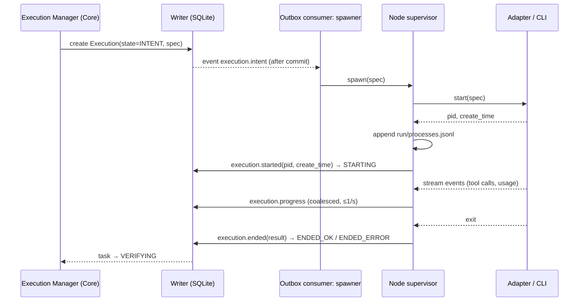
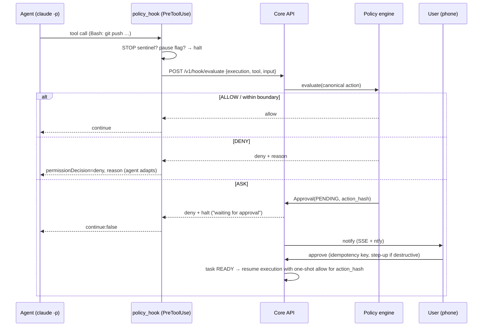

# Archeus V1 — Execution Architecture

Status: **DECIDED** (ADR-0004, ADR-0007, ADR-0008) unless marked. Entities: Execution, Session,
Checkpoint, ExecutionNode, Approval in [domain-model.md](domain-model.md). Lifecycles:
[state-machines.md §3, §4, §13](state-machines.md).

## 1. Chain of responsibility

```text
Mission → Plan → Task DAG → Resource Router → Execution Manager → Node → Harness adapter
        → Account (credentials on the node) → Model (per-execution parameter) → Session → process
```

| Component | Lives in | Responsibility | Must never |
|---|---|---|---|
| Execution Manager | Core (`core/execution/manager.py`) | turn READY tasks into Executions, apply policy to the *execution environment*, track state, derive checkpoints, merge back | spawn a process inside a DB transaction |
| Node (V1: local, in-process) | `node/local.py` | spawn/kill/adopt processes, maintain the process registry, compute worktree paths, relay adapter events | decide policy or routing |
| Harness adapter | `harnesses/<id>/adapter.py` | translate the normalised contract into a CLI invocation and parse its output stream | leak provider concepts into Core (they go in `adapter_state`) |
| Policy hook | `harnesses/claude_code/hooks/policy_hook.py` | per-tool-call ALLOW/DENY/halt, pause flag, STOP sentinel | fail open for Archeus-launched executions |

## 2. Execution environment (capability removal)

Before spawn, the manager builds the environment from the task's evaluated policy — this is the
**primary** enforcement layer (ADR-0007); hooks are secondary.

| Concern | Rule |
|---|---|
| Account env | `config.account_env(cfgdir)` sets the harness home var and pops API keys that would override the intended login (existing, reused). *Amended 2026-10-07 ([ADR-0053](decisions/ADR-0053.md) §7 A2, PV-20; not implemented):* an isolated execution never receives the account home, a copy of it, or implicit access to its configuration. Its `CLAUDE_CONFIG_DIR` is a fresh, Core-created, per-execution directory in execution-private state, holding no provider login; provider access goes only through Core's broker (R3-B). Core-authored spawn configuration (hook settings, MCP configuration) is Core-write / execution-read; ADR-0049 opt-ins enter only as Core-materialised data carrying no credential authority, and **no MCP opt-in is admitted to an isolated execution** (confirmed by the owner, 2026-10-07; changing it needs a new owner decision) |
| Push/publish credentials | removed: `GIT_TERMINAL_PROMPT=0`, `GIT_ASKPASS=` (empty), `SSH_AUTH_SOCK` unset, `GIT_CONFIG_COUNT` injects `credential.helper=` (empty) — the agent can commit locally but cannot push. `git_push`, `deploy`, `external_comm`, merge-back are **performed by Core** after policy + approval |
| Filesystem | workdir = task worktree (code_change) or project root (read-only tasks). Claude Code gets `--add-dir` only for allowed extra paths; Codex gets `--sandbox workspace-write`. *Amended 2026-10-07 ([ADR-0053](decisions/ADR-0053.md), PV-20; not implemented):* under PV-20 the process runs under an execution identity that is not the user's, inside a Core-held Job; a code-change workdir is a separate execution repository whose result Core imports as data (the user's `.git` is never exposed); and the execution reaches its model provider only through Core's broker (conditional on production CLI feasibility). Capability removal stays; it was never an OS boundary (ADR-0051 §4). *Completed by ADR-0053 §7 A1 (not implemented):* "project root (read-only tasks)" is withdrawn for isolated executions — every isolated execution, of every task kind, gets a Core-established workspace distinct from the user's project root and `.git`: a seeded execution repository on a git root (detached HEAD: the recorded commit), an empty execution-private workspace with no project; a non-git project root is refused before dispatch, never run in place |
| Network | Codex: network access off unless `web` is ALLOW. Claude Code: `WebFetch`/`WebSearch` removed from allowed tools unless `web` is ALLOW (*as built, P20 slice F: present exactly when the task holds `web`, and the hook judges each call; ADR-0052 derives removal from the classes held*); Bash network cannot be blocked by Archeus → tasks whose policy denies network are routed only to `sandbox` harnesses (router §3). *Under PV-20 (ADR-0053 §7 A4; not implemented):* a sandbox harness is eligible only if it launches inside the PV-20 execution identity and Job — its own sandbox is an inner layer, never a substitute; network egress is P23's |
| Tools | Claude Code `--allowedTools` / `--disallowedTools` derived from action classes (e.g. no `Bash` for a pure `document` task) — *amended 2026-10-03 (ADR-0052): the removal is `--tools` (allow-form, from the action classes; unmapped tools excluded) plus `--disallowedTools "mcp__*"` except opted-in servers; `--allowedTools` is never passed, because it pre-approves rather than restricts.* *As built 2026-10-07 (P20 slice F; p20-design-gate §12 items 75–89): `archeus/harnesses/claude_code/tools.py`. `--tools` is passed on every spawn, empty when the task holds no mapped class. Its names are the mapping intersected with a checked-in, version-stamped snapshot of what the installed CLI offers, because Claude Code drops an unknown name without a word; `tools/claude_tool_drift.py` compares the snapshot with the installed CLI. `Skill` is added exactly when an opted-in source or plugin brings a skill. The MCP deny is `mcp__*` with nothing opted in; otherwise it is one `mcp__<name>` per excluded server, in Claude Code's normalised name. A name colliding with an opted-in server's, or a server the inventory cannot name, is left to `--strict-mcp-config`.* |
| Limits | `--max-turns` from task size; `--max-budget-usd` where the harness supports it; wall-clock timeout per task kind |
| Tagging | `ARCHEUS_EXECUTION_ID`, `ARCHEUS_HOME`, `ARCHEUS_CORE_URL`, `ARCHEUS_HOOK_TOKEN` (a `hook_…` token: execution-scoped, report/checkpoint/request_approval only) and the legacy `HEADLESS_MARK` so today's session lists and auto-memory skip these transcripts. `ARCHEUS_EXECUTION_ID` also makes the legacy account hooks stand down (P0.5 hook guard): `recall_hook`, `worklog_hook`, `memdirty_hook` skip; `limit_hook` records the shared latch but does not offer rotation |

## 3. Harness adapter contract

Frozen in P1 so the fake harness and the acceptance judge can be written first.

```python
class HarnessAdapter(Protocol):
    id: str
    def discover(self) -> HarnessInfo: ...                      # installed? version? executable
    def capabilities(self, account: AccountRef) -> Capabilities: ...   # incl. models offered, enforcement
    def authenticate(self, account: AccountRef) -> AuthStatus: ...     # cheap probe, no inference
    def start(self, spec: ExecutionSpec) -> ProcessHandle: ...        # spawn; returns pid+create_time
    def send(self, handle, message: str) -> None: ...           # interactive/streaming input (optional)
    def pause(self, handle) -> PauseResult: ...                 # cooperative: set flag, await boundary
    def resume(self, spec: ExecutionSpec, state: AdapterState) -> ProcessHandle: ...
    def stop(self, handle, *, grace_s: float) -> None: ...
    def inspect(self, handle) -> Snapshot: ...                  # tail of stream, usage so far, pressure
    def status(self, handle) -> ProcStatus: ...
    # (no handoff(): P12 builds a continuation as an ordinary INTENT whose prompt
    #  ends with the checkpoint's rendering — p12-design-gate D19)
    def collect_result(self, handle) -> ExecutionResult: ...    # exit, summary, usage, artifacts, session ref
    # added in P6 (ADR-0022), only on adapters declaring `headless`:
    def call(self, spec: CallSpec) -> CallResult: ...           # one tool-less, ephemeral, read-only call
```

`CallSpec` = `{route_decision_id, prompt (stable prefix + variable suffix), workdir, env, model,
schema?, limits}` and `CallResult` = `{text, parsed?, usage, error?}`. The adapter keeps the call
read-only and ephemeral in its own flags and requests the schema natively or in the prompt
(`Capabilities.structured_output = native | prompted`); Core validates `parsed` against the
schema either way (ADR-0006). A call has no Session and no Execution. **As built (P6):**
`CallSpec = {route_decision_id, purpose, prompt, workdir, account, schema?, model?, limits}`,
`CallResult = {text, parsed?, usage, error?, detail}` with `error` one of `unavailable`,
`model_unavailable`, `timeout`, `failed`; the real `call()` adapters live in
`archeus/harnesses/calls.py`, outside the P1 registry, and have no `start()`.

**Vocabulary belongs to the harness** (ADR-0022): `model` is an id the target account offers
(ModelOffer) and `effort` a level the adapter declares in `Capabilities.efforts`. Core never passes
another harness's model or effort, or a default made for one; a value the target does not know
is dropped, never translated (a bare Claude id sent to pi is refused as ambiguous across
providers).

`ExecutionSpec` = `{execution_id, task_contract, prompt (stable prefix + variable suffix),
workdir, env, model, effort, limits, allowed_tools, resume_ref?, hook_settings}`. `ExecutionResult` =
`{exit_reason, reported_summary, usage, session_ref, transcript_path, files_changed?}` — the
reported summary is **never** the completion signal (verification is).

| Adapter | Headless invocation (verify exact flags in the P11 contract test) | Stream | Resume | Enforcement |
|---|---|---|---|---|
| `fake` | Python script driven by a scenario file | JSON lines | yes | simulated hook |
| `claude_code` | `claude -p --output-format stream-json --verbose --session-id <uuid> --model … --effort … --max-turns … --settings <per-execution settings file with the policy hook>` | stream-json (assistant/tool events, `usage`, `compact_boundary`) | `--resume <session uuid>` | hook (PreToolUse, PreCompact) |
| `claude_code` interactive | existing `main.build_launch_command` + `proc.spawn_terminal` | transcript tail | n/a | hook in fail-open mode (user's own session) |
| `codex` | `codex exec --json --sandbox workspace-write -m …` | JSON events | `codex exec resume <id>` | sandbox |
| `pi` | `call()`: `pi -p --no-session --tools read,grep,find,ls --model <provider/id>` (ADR-0022); user sessions: its launch argv; tool-using execution DEFERRED (RPC mode) | JSON | `--session` of the recorded session | none |

Hooks are installed **per execution** through the settings file passed at start, not by editing
the user's global `settings.json`, so V1 executions never collide with legacy hook ownership
(ADR-0019).

### 3.1 Process I/O contract (frozen in P1, same for every adapter including `fake`)

All files live in `<ARCHEUS_HOME>/run/exec/<execution_id>/`:

| File | Written by | Purpose |
|---|---|---|
| `spawning` | spawner, **before** the process is created | marker `{execution_id, attempt, at}`; its presence without `ended` means "a process may exist" |
| `prompt.txt` | spawner | the prompt; the process reads it as **stdin** (`proc.spawn_detached(..., stdin_path=)`), which avoids command-line length limits and survives Core restarts |
| `stream.jsonl` | the process (stdout and stderr redirected) | the normalised event stream Core **tails**; never a pipe, so a restarted Core can re-attach |
| `pid.json` | spawner, immediately after creation | `{pid, create_time}`; the append to `run/processes.jsonl` is P11's supervisor (p3.5b-design-gate.md A36: no code before P11 writes it) |
| `ended` | Core, when the exit is observed | `{exit_code, at}` tombstone |

Spawn rule (idempotent under outbox re-delivery): if `spawning` exists without `ended`, the
spawner **does not spawn again**; it hands the execution to reconciliation, which adopts the
process named by `pid.json` (pid and create time match and `stream.jsonl` is still growing) or,
when `pid.json` is missing (crash between creation and recording), marks the execution LOST,
kills any process that match the recorded argv in the execution's workdir if one can be
identified, and never re-spawns into the same worktree without a new attempt number.

*Amended 2026-10-07 ([ADR-0053](decisions/ADR-0053.md), PV-20; not implemented).* For an execution
launched under PV-20 isolation: this directory's contents split into PV-20's seven resource classes
on separate boundaries (pv20-execution-isolation-design §7.5); `spawning`, `pid.json` and `ended`
are Core-only lifecycle state and are never read from an execution-writable location; the prompt
and stream reach the process as Core-opened handles; and the "a restarted Core can re-attach"
property does not apply, because Core's death terminates the isolated tree (R6-A). Exact files and
directories are implementation work. *Further, under ADR-0053 §7 A1, A2 and A7:* the workdir is
never this directory itself (an execution with no project gets an empty execution-private
workspace); Core-authored spawn configuration has the response class's authority (Core writes, the
execution reads); and `stream.jsonl`'s content is execution-authored — a `result` in it is never a
process exit, while the `ended` tombstone Core writes is.

*As built 2026-10-12 (PV-20 S2-L, `13c1172`, not yet accepted; p20-design-gate §12 item 103).*
The directory holds the class directories below, for **every** execution, isolated or not. Core
creates `req/`, `res/` and `ctl/` at spawn. The files above stay in the directory itself, which is
Core's (class 4).

| Directory | Class | Written by | Holds |
|---|---|---|---|
| `req/` | 1 | the execution (the hook) | `<seq>.lock`, `<seq>.req.json`, `halted.json`, `precompact.json` |
| `res/` | 2 | Core | `<seq>.res.json`, the spawn configuration (`settings.json`, `mcp.json`) |
| `ctl/` | 3 | Core | the `STOP`, `PAUSE` and `HANDOFF` flags |
| `own/work` | 7 | the execution | the workspace of an execution with no project |
| `own/state` | 7 | the execution | its runtime state |

The global `<ARCHEUS_HOME>/run/STOP` sentinel is unchanged.

## 4. Process lifecycle



- **Registry.** `<ARCHEUS_HOME>/run/processes.jsonl` lines `{execution_id, pid, create_time, argv0,
  started_at}`; tombstoned on exit. It exists so `archeus estop` and boot reconciliation work
  without the database. Per-execution files (§3.1) carry the spawning marker and the stream.
  **P11** — until then nothing writes it (p3.5b-design-gate.md §18.1).
- **Boot reconciliation.** *P3.5b* runs the kill-and-retry half of this at every Core start
  (`Engine.reconcile_orphans()`, over the database and the per-execution files, whatever state
  the mission is in): a live orphan is killed by pid + `create_time`; a recycled pid is treated
  as the process having exited and nothing is killed; the attempt ends LOST → ENDED_KILLED (or
  ABANDONED) and the task retries. The adopt branch, live tailing and the registry below are
  **P11**. For every execution in STARTING/RUNNING/PAUSING/LOST: check pid +
  `create_time` (Windows: `GetProcessTimes` via `ctypes`; POSIX: `/proc/<pid>/stat` or `ps`).
  Alive and `stream.jsonl` still growing → adopt (resume tailing from the last offset Core
  recorded). Dead → derive a
  checkpoint, mark ENDED_ERROR or LOST → task retry per policy. INTENT rows follow the
  spawning-marker rule of §3.1 (no marker → ABANDONED; marker without `pid.json` → LOST;
  marker with `pid.json` → adopt or kill). *Amended 2026-10-07 ([ADR-0053](decisions/ADR-0053.md)
  R6-A; not implemented):* an execution launched under PV-20 isolation is **never adopted**. Core
  is the sole holder of its Job and Core's death terminates its tree, so boot reconciles records
  and resolves every remaining non-terminal isolated execution through terminate / reap / fail
  (p11-design-gate §15.3).
- **Stop.** `stop` → hook halt flag (graceful, ≤ `grace_s`) → `proc.kill_pid_tree(pid,
  create_time)` (P0.5 seam; refuses a recycled PID). *Under PV-20 (ADR-0053 R6-A; not
  implemented):* with Core up, the forced step ends the execution's Core-held Job, which reaps the
  whole tree; `kill_pid_tree` stays the instrument of the Core-less `archeus estop` (§10 path 2).
- **Ending (ADR-0053 §7 A7; not implemented).** `execution.ended` → ENDED_OK is an execution-level
  fact, not success: Core records it only from its own observed exit 0 of an execution that was
  RUNNING with no outstanding Core control request, and it moves the task only to VERIFYING. A
  PAUSING or HANDING_OFF execution never reaches ENDED_OK because the execution reports success;
  ambiguous termination is non-advancing.
- **Pause.** cooperative (state-machines §4). The mission shows "pausing…" until every execution
  reports PAUSED or escalates to stop at `pause_timeout`.

## 5. Policy at action time (ASK mid-execution)



- **Fail-closed** for Archeus-launched executions: if Core is unreachable (timeout 5 s) the hook
  denies write/exec/network actions and allows pure reads. For the user's own interactive
  sessions the same hook fails open (today's `guard_hook` behaviour), because blocking a human's
  terminal when Core is down is worse than the risk.
- **Canonicalisation:** the hook sends raw tool input; Core canonicalises it into
  `{class, target, argv, diff_hash}`. Bash commands are classified by a conservative parser
  (known git/deploy/package-manager verbs → specific classes; anything with pipes into a shell,
  `eval`, base64 decoding, or unknown binaries in a denied-network task → `exec` with
  `unclassified=true`, which policy treats as the *strictest* class active for the task). The
  classifier is a convenience; capability removal (§2) is the guarantee.
- The one-shot allow is a signed token `hmac(hook_token, action_hash)` delivered in the resumed
  execution's environment and consumed on first use (Approval → CONSUMED). *Corrected 2026-10-07
  (ADR-0053 §2 and §7 A7):* that design is withdrawn — the execution holds its hook token, so it
  could compute such a token itself, and authoring approval state is a PV-20 §3.6 effect. As built
  (p11-design-gate §10.4 step 6), the approval is consumed **Core-side**: P9's
  `authorization.evaluate_action` finds the covering Approval for the action hash and consumes it,
  single-use, in the same transaction; nothing the execution holds or presents is the approval.

## 6. Continuity: checkpoints and hand-off

**When:** task boundary (always), context pressure ≥ 0.75, account change (limit/fallback),
pause-timeout stop, failure, user request "continue in a fresh session".

**Context pressure signal** (headless): after each assistant message in stream-json,
`pressure = (usage.input_tokens + usage.cache_read_input_tokens + usage.cache_creation_input_tokens)
/ model.context_window` (the window of the execution's model from the account's offers or the
adapter's declared models; an unknown model uses the smallest window that harness declares, so
pressure is over- rather than under-estimated, and a harness declaring none has no pressure
hand-off — recorded, not guessed; p12-design-gate §13.1, as built). Backstops: the PreCompact hook fires →
treat as pressure 0.9; a `compact_boundary` event → record that compaction happened (the
execution continues; the checkpoint is still derived at the next boundary). Bounded tasks and
`--max-turns` keep pressure rare — hand-off is the exception path, not the design.
*(ADR-0047, DECIDED and built in P21 — `execution/pressure.py`, `executions.no_progress`,
`LocalNode.end_state`: each pressure value is recorded with its basis — window, window source,
usage offset, the PreCompact signal — and read as signalled / unavailable / stale / estimated /
reported; a pressure continuation whose recorded end state shows no progress over every earlier
link of its chain ends `ENDED_HANDOFF` charged, with `context_insufficient` taking the ordinary
retry and replan path, rather than handing off again; a chain that keeps progressing has no count
cap and is bounded by its resources, P9, P10, the e-stop and the user; Archeus triggers no
compaction.)*

**What a checkpoint contains** — **derived by Core**, not asked of an agent whose context is
already full:

| Field | Source |
|---|---|
| objective, constraints, success criteria | Mission + Task rows |
| completed_steps | task graph + events |
| files_changed | `git diff --stat` + diff artifact in the workdir |
| verification | latest Verification rows |
| decisions | V1: every line of the agent's output that begins with `DECISION:` (the task contract instructs the agent to state decisions that way), parsed from `stream.jsonl` by the adapter, plus DECISION items Core created in the mission. An execution-scoped decision API is not in V1 |
| open_problems | failing checks, hook denials, last error |
| next_action | planner's next step for the task; if unknown, "continue the task from the diff" |
| relevant_context_refs | context package ids used, re-assembled for the next execution |

Rendered as markdown artifact → the next Execution's prompt gets it as the variable suffix
(today's `context_inject` writes a transcript dump to `.archeus/injected-context.md`; V1 replaces
the dump with the checkpoint, reusing the injection mechanism).

**Hand-off flow:** HANDING_OFF → checkpoint written → ENDED_HANDOFF → router (affinity kept
unless the trigger was an account problem) → new Execution with `handoff_from`. Mission and task
states do not change. The user sees "Dashboard implementation is continuing", not "session 19
has 83k tokens" (spec §17).

**As built (P12, p12-design-gate §31).** Every end of an execution that ran derives one
Checkpoint in the transaction of the end; a hand-off (pressure ≥ 0.75 or the PreCompact backstop,
a provider limit, a ceiling crossing, or the user) halts at the next tool call on the node's
`HANDOFF` flag, ends ENDED_HANDOFF uncharged, and creates the continuation through P9
`check_dispatch` and P10 `route` in the same transaction — `attempt + 1` rather than "attempt
unchanged" (`UNIQUE (task_id, attempt)`), charged attempts only counting against the budget.
User sessions have their own adapter protocol (`harnesses/sessions.py`: `locate`, `launch_argv`,
`turns`, `find`) over `claude_sessions.launch.build_launch_command`.

**User-session hand-off and resume** (ADR-0023, P11–P12). A user's own session (mode
`interactive_attached` / `manual`) resumes through its own harness's adapter from what its
Session recorded — never with another harness's model, effort or defaults. Handing it to another
harness or account: the user picks the target among installed `interactive` harnesses (the
source's own harness first); Core renders the hand-off artifact (the checkpoint when the session
belongs to a mission; transcript-derived when it does not, the stated exception to ADR-0004); the
target adapter's `handoff()` delivers it through a channel that harness has (a system-prompt
flag, or an opening message pointing at the artifact — the one channel every supported CLI shares); a new Session records `handoff_from_session_id`; the
source Session is left as it was; `session.handed_off` is written. `.archeus/injected-context.md`
is the legacy delivery of this, not the contract.

## 7. Worktrees and merge-back

- Code-change tasks run in a worktree at a **node-computed path**:
  `<ARCHEUS_HOME>/worktrees/<project-slug>/<mission-id>/<task-key>` (outside the repository, as
  Vicoa does), branch `archeus/<mission-id>/<task-key>`. Removal is allowed only for paths the
  node created *and* `git worktree list` confirms (reuses `worktrees.py` helpers and the
  `.git`-is-a-file classifier from `repos.py`).
- After the task verifies, the Integration machine (state-machines §13) merges into the mission
  branch; mission-level verification runs on the mission branch; final integration into the
  user's working branch and any push are separate policy-checked actions performed by Core.
- Parallel tasks in a DAG each get a worktree, which is what makes parallelism safe. Tasks that
  touch the same files are serialised by the planner (declared `touches[]` globs).
- *Amended 2026-10-07 ([ADR-0053](decisions/ADR-0053.md) R4a-B; not implemented):* under PV-20 a
  code-change task works in a **separate execution repository**, not a linked worktree of the
  user's repository, because a linked worktree shares the user repository's refs, objects, config
  and hooks. Core seeds it and brings its result into the mission branch by a data-only import that
  honours none of its configuration, hooks or refs; the merge and everything after it stay Core's.
  Mission-level verification on the mission branch runs under the confined verification identity
  (§8).
- *Completed 2026-10-07 by ADR-0053 §7 A1 and A5 (not implemented):* every isolated execution of
  every task kind on a git root gets such a repository, seeded by a **copy** of the base revision
  only (never a linked worktree, shared objects, alternates or hardlinks). Core never runs git
  against it under the user's identity — `git worktree list` above included. Core copies its working
  tree as data into a Core-owned import repository; **Core's pinned import commit is the canonical
  revision**. Every Core git operation over execution-derived content — the import commit, git
  facts, the merge, materialising a verification checkout, push — runs under a Core-pinned
  configuration that prevents execution-controlled hooks, drivers and configuration from running.
  **Confirmed by the owner (2026-10-07):** no repository-controlled or execution-derived git
  extension executes in those operations — repository-controlled hooks (the user's own included),
  filters, fsmonitor, diff and merge drivers, submodules, LFS transfer mechanisms, and any other
  execution-derived git extension — and Core does not push content whose publication requires
  executing one (for example LFS-dependent content); that capability needs a separate owner
  decision (PV-20 §3.2).

## 8. Verification providers

| Verifier | Checks | Independence |
|---|---|---|
| CodeVerifier | `test_commands` and `build_commands` from the latest RepositoryInspection (fallback: detected by marker files — `pyproject.toml` → pytest, `package.json` → `npm test`, …), plus lint if configured, plus architecture consistency check (drift) on changed modules | deterministic; runs on the node. *Amended 2026-10-07 ([ADR-0053](decisions/ADR-0053.md) R4b; not implemented):* execution-influenced verification runs under the **confined verification identity** — distinct from the user's and the execution's identity, no access to Core state, credentials or the local token, its own Job — against a checkout at the recorded revision, **never under the user's identity**; Core records the exit code and output itself; network per P23's policy. If that identity cannot be established, no command runs and the check is missing evidence (p13-design-gate §8.1, §8.4: ERROR or AWAITING_HUMAN, never PASSED). As built today the commands still run as the user in the worktree — PV-20's open remediation. *ADR-0053 §7 A6:* one fresh verifier principal per verification, never reused; a fresh checkout of the Core-recorded revision; no persistent or shared cache; no credential, Core state or Core route; authority a subset of the execution's runtime/tool grants plus its own checkout and scratch, network only if P23 permits |
| ResearchVerifier | every claim in the report cites a source; sources fetched and quoted; contradictions flagged; confidence recorded | model call on a different account/model when possible |
| DocumentVerifier | required sections present, links resolve, spelling/format checks | deterministic + optional model |
| PresentationVerifier | export exists and opens, slide/scene count, requirement checklist; visual quality → human acceptance | mostly human |
| AutomationVerifier | trigger fired, action executed, expected outcome observable | deterministic |
| GenericVerifier | creates an Attention "accept this result?" item | human |

Review is separate (verification-and-review in state-machines §6–7).

## 9. Execution nodes

**V1:** one local node, in-process, implementing the node contract below. **DEFERRED:** remote
nodes (a second PC, a server) — specified now so V1 code does not assume locality.

| Contract | Local (V1) | Remote (deferred) |
|---|---|---|
| Transport | function calls | node opens outbound HTTPS to Core: `GET /v1/node/stream` (SSE commands: spawn, stop, pause, inspect) and `POST /v1/node/events` (reports). Outbound-only so nodes behind NAT work. |
| Identity | implicit | node principal + node token (typed, hashed at rest, revocable), paired like a device |
| Liveness | process-registry check | socket-as-liveness + 30 s heartbeat; GRACE 90 s; OFFLINE after |
| Credentials | accounts registered on this node | accounts are node-bound; Core never receives credentials, only usage snapshots and auth status |
| Artifacts | same disk | node uploads artifacts by sha256; Core dedups |
| Offline | n/a | node keeps running executions, buffers events (bounded), replays on reconnect; Core marks executions LOST after grace and reconciles on reconnect. *Open under PV-20 (ADR-0053 R6-A; recorded 2026-10-07):* this row conflicts with R6-A for isolated executions, under which no isolated process outlives the Core that holds its Job. Remote nodes are deferred; before one runs isolated executions it needs its own PV-20 analysis — nothing here decides it |

## 10. Emergency stop

Two paths, both documented in the UI:

1. **Core running:** "Stop everything" (desktop, phone, CLI `archeus pause all --now`) → Core
   writes the STOP sentinel, moves all executions to STOPPING, disables automations and refuses
   new routing until the user re-arms.
2. **Core down or unreachable:** `archeus estop` (or the desktop shell's tray item, which runs
   the same code, dispatched without starting Core) writes `<ARCHEUS_HOME>/run/STOP` and kills
   every live process in `processes.jsonl` whose create_time matches (`kill_pid_tree`).

Semantics:
- **Hook-enforced harnesses** (Claude Code): the policy hook checks the sentinel first, using
  the `ARCHEUS_HOME` the execution was started with, so it halts at the next tool call even with
  Core down.
- **Sandbox harnesses** (Codex) have no per-call hook: the sentinel cannot reach them; they are
  stopped only by the registry kill.
- **The sentinel persists.** Core starting with `STOP` present comes up **disarmed**: it
  reconciles and reports, but starts no execution, fires no automation and refuses routing until
  an explicit `rearm` from a user device with the `control` scope, which deletes the sentinel
  and records an event.
- Remote stop from a phone needs Core running; the docs and the pairing screen say so plainly.
  Worst case with Core down is bounded by capability removal (no push, no deploy), the sentinel
  (hook harnesses) and the registry kill (all harnesses). *Corrected 2026-10-07 (PV-20, ADR-0053):*
  capability removal does **not** bound this as built — finding G1 (Critical, open) shows the push
  and publish credentials live in stores the user's identity owns, which removing environment
  variables cannot reach. The bound is PV-20's once implemented and evidenced; until then the
  sentinel and the registry kill are the Core-down controls.
- *Amended 2026-10-07 ([ADR-0053](decisions/ADR-0053.md), PV-20; not implemented):* path 2 stays
  **the only Core-less stop mechanism** (p20-design-gate §4.1 item 83). Under PV-20 the Job is the
  execution lifetime boundary, held only by Core, and Core's death ends an isolated tree; the Job
  is **not** a second, independent Core-down stop authority. The sentinel check is an explicit
  three-state determination (present / absent / indeterminate → halt) since PV-20 slice S0
  (2026-10-08; p20-design-gate §12 item 101), which lands it before PV-20's separation of the
  sentinel from the mailbox; that is not row 7's verification. Under ADR-0053 §7 A4 a sandbox harness runs
  inside a Core-held Job like every other execution, and under A6 so does every verifier principal:
  both are in the registry path 2 kills.
